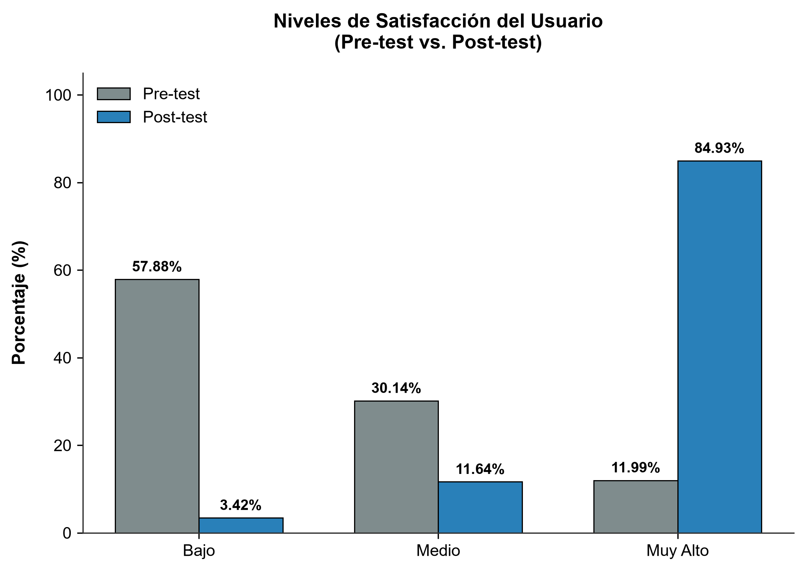
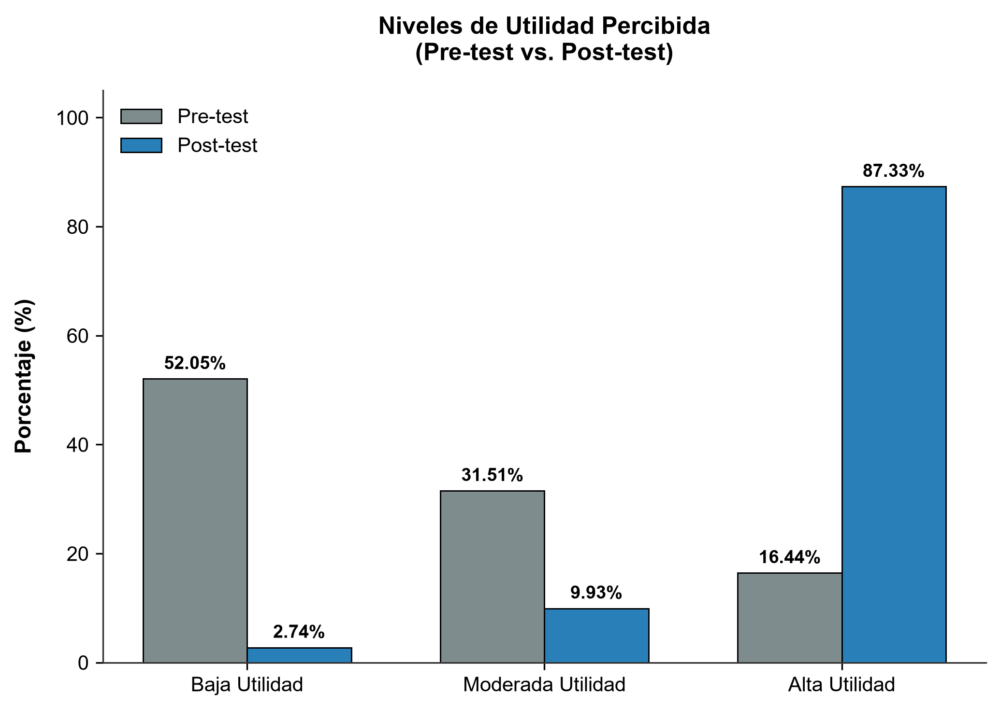
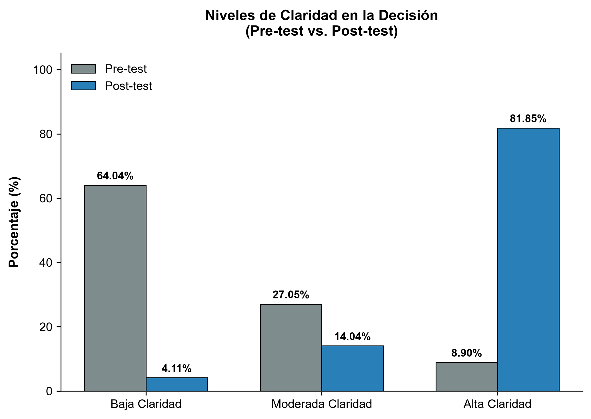
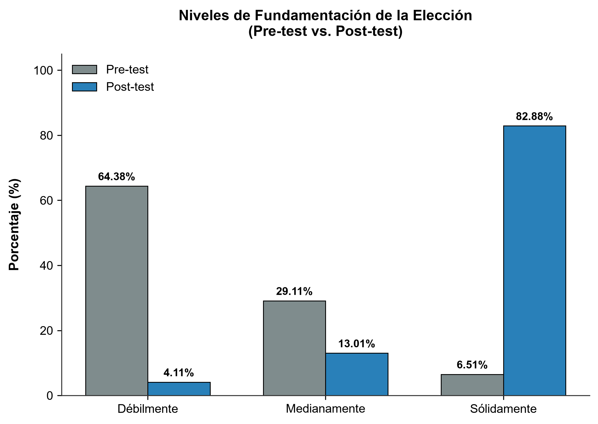

## **FACULTAD DE INGENIERÍA** 

Escuela Académico Profesional de Ingeniería de Sistemas e Informática 

## TESIS 

**App Móvil con Chatbot de recomendación para programas de especialización para estudiantes egresados de pregrado de la Universidad Continental, Huancayo –** 

**2026** 

## Autor 

José Anthony Bacilio De La Cruz 

Para optar el Título Profesional de 

**==> picture [596 x 61] intentionally omitted <==**

## Ingeniero de Sistemas e Informática 

Huancayo - Perú 

2026 

## **ÍNDICE** 

```
Pág.
```

_Índice................................................................................................................ii Lista de tablas..................................................................................................iv Lista de figuras.................................................................................................v Resumen..........................................................................................................vi Abstract...........................................................................................................vii Introducción......................................................................................................8_ 

## **CAPÍTULO 1** 

## _PLANTEAMIENTO DEL ESTUDIO_ 

|1.1.|Planteamiento y formulación del problema.........................................9|
|---|---|
||1.1.1.<br>Problema general.................................................................9|
||1.1.2.<br>Problemas específicos..........................................................9|
|1.2.|Objetivos..............................................................................................9|
||1.2.1.<br>Objetivo general....................................................................9|
||1.2.2.<br>Objetivos específicos............................................................9|
|1.3.|Justificación e importancia...................................................................9|
|1.4.|Delimitación del proyecto.....................................................................9|
|1.5.|Hipótesis y variables............................................................................9|


## **CAPÍTULO 2** 

## _MARCO TEÓRICO_ 

|2.1.|Antecedentes de la investigación......................................................10|
|---|---|
|2.2.|Bases teóricas...................................................................................10|
||**CAPÍTULO 3**|
||_MÉTODOLOGÍA_|
|3.1.|Método, tipo o alcance de la investigación........................................11|
|3.2.|Materiales y Métodos.........................................................................11|
||**CAPÍTULO 4**|
||_RESULTADOS Y DISCUSIÓN_|
|4.1.|Presentación de resultados...............................................................12|
|4.2.|Discusión de resultados.....................................................................12|
||**CAPÍTULO 5**|
|_CONCLUSIONES Y RECOMENDACIONES_||
|5.1.|Conclusiones.....................................................................................13|
|5.2.|Recomendaciones.............................................................................13|
|_Referencias bibliográficas..............................................................................14_||


## _**ANEXOS**_ 

|Anexo A.|Matriz de consistencia.......................................................................16|
|---|---|
|Anexo B.|Matriz de operacionalización.............................................................17|
|Anexo C.|Instrumentos de recolección de datos...............................................18|


## **LISTA DE TABLAS**

**Tabla 1.** Estadísticos de contraste de Wilcoxon para la Hipótesis General (HG).............................52
**Tabla 2.** Comparativo de niveles de Satisfacción del Usuario (Pre-test vs. Post-test).......................53
**Tabla 3.** Estadísticos de contraste de Wilcoxon para la Hipótesis Específica 1 (HE1).......................54
**Tabla 4.** Comparativo de niveles de Utilidad Percibida (Pre-test vs. Post-test).............................55
**Tabla 5.** Estadísticos de contraste de Wilcoxon para la Hipótesis Específica 2 (HE2).......................56
**Tabla 6.** Comparativo de niveles de Claridad en la Decisión (Pre-test vs. Post-test)........................57
**Tabla 7.** Comparativo de niveles de Fundamentación de la Elección (Pre-test vs. Post-test)..................57
**Tabla 8.** Estadísticos de contraste de Wilcoxon para la Hipótesis Específica 3 (HE3).......................58
**Tabla 9.** Métricas de Calidad de Software y Requerimientos No Funcionales (RNF) Logrados...................59

## **LISTA DE FIGURAS**

**Figura 1.** Niveles comparativos de Satisfacción del Usuario (Pre-test vs. Post-test).........................52
**Figura 2.** Niveles comparativos de Utilidad Percibida (Pre-test vs. Post-test)...............................53
**Figura 3.** Niveles comparativos de Claridad en la Decisión (Pre-test vs. Post-test)..........................54
**Figura 4.** Niveles comparativos de Fundamentación de la Elección (Pre-test vs. Post-test)...................55
**Figura 5.** Arquitectura tecnológica del sistema conversacional Cori/Horizonte..............................46 

## **RESUMEN** 

La  presente  investigación  tuvo  como  propósito  evaluar  la influencia de una aplicación móvil con chatbot de recomendación en la toma de decisiones sobre la especialización profesional  en  estudiantes  egresados  de  pregrado  de  la Universidad Continental, Huancayo, en el año 2026. El problema de estudio se centró en la elevada incertidumbre vocacional de los  egresados  y  en  la  limitada  efectividad  de  los  sistemas tradicionales de orientación académica. El objetivo principal consistió en desarrollar y evaluar una app móvil con un chatbot conversacional adaptativo basado en el modelo RIASEC para facilitar este proceso decisorio. La metodología presentó un enfoque cuantitativo, de tipo aplicada y diseño pre-experimental con pre-test y post-test, aplicado sobre una muestra probabilística  de  292  egresados.  Los  resultados  revelaron mejoras  estadísticamente  significativas  tras  la  intervención; registrando que la satisfacción del usuario aumentó del 11.99% al 84.93%, mientras que la utilidad percibida alcanzó un nivel alto en el 87.33% de los participantes. Asimismo, el análisis inferencial  mediante  la  prueba  de  Wilcoxon  confirmó  la hipótesis  general  ( _Z_ =−14.652, _p_ =0.000),  corroborando  un incremento crítico en la claridad y fundamentación del egresado respecto a su elección académica final (del 6.51% al 82.88%). Se concluyó que la implementación del chatbot conversacional inteligente y personalizado optimiza significativamente la toma de decisiones sobre especializaciones académicas mediante la reducción  de  la  sobrecarga  de  información  y  la  adecuada alineación vocacional, constituyendo una solución tecnológica altamente viable para la gestión educativa superior. 

**Palabras clave** : Chatbot, toma de decisiones, especialización profesional, RIASEC, aplicación móvil, orientación vocacional. 

## **ABSTRACT** 

This  research aimed to evaluate  the  influence  of  a  mobile application with a recommendation chatbot on decision-making regarding  professional  specialization  among  undergraduate graduates from Universidad Continental, Huancayo, in the year 2026. The research problem focused on the high vocational uncertainty  of  graduates  and  the  limited  effectiveness  of traditional academic guidance systems. The main objective was to  develop  and  evaluate  a  mobile  app  with  an  adaptive conversational chatbot based on the RIASEC model to facilitate this decision-making process. The methodology employed a quantitative  approach with an  applied and  pre-experimental design using pre-test and post-test, applied to a probability sample  of  292  graduates.  The  results  revealed  statistically significant improvements after the intervention, showing that user  satisfaction  increased  from  11.99%  to  84.93%,  while perceived usefulness reached a high level in 87.33% of the participants. Likewise, inferential analysis using the Wilcoxon signed-rank test confirmed the general hypothesis ( _Z_ =−14.652, _p_ =0.000), corroborating a critical increase in the clarity and reasoning of graduates regarding their final academic choice (from 6.51% to 82.88%). It was concluded that the implementation of an intelligent, personalized conversational chatbot  significantly  optimizes  decision-making  regarding academic specializations by reducing information overload and ensuring  proper  vocational  alignment,  constituting  a  highly viable technological solution for higher education management. 

**Key words** : Chatbot, decision-making, professional specialization, RIASEC, mobile application, vocational guidance. 

```
12
```

## **INTRODUCCIÓN** 

En el contexto actual de la educación superior y el mercado laboral dinámico, los estudiantes universitarios egresados de pregrado se enfrentan al complejo desafío de seleccionar un área de especialización profesional óptima. La vertiginosa evolución de las demandas productivas, sumada a la diversificación de las mallas académicas y programas de posgrado, exige que la toma de decisiones curriculares se fundamente en un análisis preciso y personalizado. No obstante, los canales tradicionales de consejería y tutoría universitaria suelen caracterizarse por limitaciones de cobertura, disponibilidad asincrónica y altos costos operativos, lo cual resulta insuficiente para orientar a grandes poblaciones estudiantiles de manera personalizada (10). Diversos autores señalan que esta carencia fomenta la deserción de programas formativos, la subempleabilidad  y  altos  niveles  de  frustración  académica  y  profesional  en  los egresados (6). Frente a esta realidad, la Ingeniería de Sistemas e Informática provee un marco  estratégico  a  través  de  la  integración  de  plataformas  móviles  y  agentes inteligentes  conversacionales  (chatbots)  orientados  a  facilitar  la  resolución  de problemas  cognitivos  complejos  mediante  la  automatización  de  la  orientación informativa y el filtrado adaptativo de información académica (5). 

La problemática central abordada en esta tesis se asienta en la elevada incertidumbre vocacional detectada en los egresados de pregrado de la Universidad Continental, Huancayo, en su proceso de transición hacia el posgrado y la especialización laboral en el  año  2026.  La  sobrecarga  informativa  del  catálogo  de  cursos  y  la  falta  de autoconocimiento  de  los  egresados  en  torno  a  sus  competencias  e  intereses profesionales inducen a decisiones académicas basadas en heurísticas informales o influencias sociales ajenas a su verdadero potencial (3). Desde la perspectiva técnica e institucional, la universidad carece de plataformas inteligentes capaces de procesar dialógicamente perfiles vocacionales únicos y emparejarlos en tiempo real con sus planes de estudio vigentes. Esta desconexión operativa no solo desfavorece al egresado, sino que restringe la capacidad de la institución para captar de forma coherente 

```
13
```

estudiantes en sus programas de posgrado y diplomados especializados, reduciendo la eficiencia de sus procesos de orientación educativa. 

Frente a esta situación, la investigación plantea el desarrollo y la posterior evaluación empírica de una aplicación móvil con chatbot de recomendación vocacional adaptativa denominada "Cori/Horizonte". El propósito fundamental del estudio consistió en determinar si la interacción sistemática del egresado con el chatbot conversacional influye positivamente en su proceso decisorio, incrementando su grado de satisfacción con la orientación y elevando la claridad y la fundamentación cognitiva de su elección vocacional. Con este fin, el chatbot incorpora un algoritmo de diagnóstico basado en la teoría de personalidades vocacionales de John Holland (RIASEC), traduciendo los resultados  psicológicos  del  usuario  en  rutas  curriculares  de  especialización recomendadas de forma inmediata. 

Desde el punto de vista teórico, el estudio se fundamenta de forma interdisciplinaria. En primer lugar, la teoría psicométrica RIASEC de Holland (3) clasifica los intereses individuales en seis dimensiones operativas (Realista, Investigador, Artístico, Social, Emprendedor y Convencional), ofreciendo una  base  estructurada  para  emparejar perfiles personales con entornos laborales correspondientes. En segundo lugar, se utiliza el Modelo de Aceptación Tecnológica (TAM) propuesto por Davis (1), el cual postula que la utilidad percibida y la facilidad de uso son los factores críticos que determinan la adopción de nuevas aplicaciones digitales. Complementariamente, se asume el Modelo de Éxito de Sistemas de Información de DeLone y McLean (2) para explicar cómo la calidad de las respuestas y la confiabilidad operativa del chatbot determinan la satisfacción acumulada del usuario final. Por último, bajo los principios de  la  Teoría  de  la  Carga  Cognitiva  de  Sweller (7),  se  sustenta  que  la  entrega fragmentada e interactiva de información curricular mediante diálogos conversacionales previene la saturación cognitiva y fomenta un aprendizaje reflexivo y seguro. 

En lo relativo a los antecedentes científicos, el desarrollo de interfaces conversacionales para la gestión educativa superior ha cobrado una relevancia significativa en los últimos años. Diversas investigaciones demuestran que los chatbots educativos con inteligencia artificial no solo actúan como sistemas de preguntas frecuentes, sino como orientadores interactivos  que  incrementan  la  motivación  del  estudiante  y  reducen  la  carga 

```
14
```

administrativa institucional (4). Sin embargo, la literatura científica de Ingeniería de Sistemas resalta que la mayoría de desarrollos se limitan a la fase conceptual o carecen de validación experimental rigurosa en entornos productivos de América Latina (10). La persistencia de sistemas rígidos con baja usabilidad móvil evidencia la necesidad de consolidar metodológicamente arquitecturas de recomendación conversacionales que conecten  constructos  psicológicos  del  estudiante  con  bases  de  conocimiento institucionales dinámicas. 

La importancia de la presente investigación reside en sus múltiples aportes. En el plano académico y científico, contribuye a la literatura de sistemas inteligentes y tecnología educativa mediante un marco teórico integrado para evaluar interfaces NLP adaptadas a la toma de decisiones académicas. Tecnológicamente, proporciona la arquitectura formal y la documentación de implementación de una aplicación móvil dotada de lógica RIASEC y procesamiento lingüístico. Metodológicamente, provee un cuestionario estandarizado y validado estadísticamente para la evaluación de usabilidad, utilidad y claridad decisional de agentes conversacionales. Finalmente, a nivel organizacional, ofrece a la Universidad Continental una herramienta innovadora de transformación digital y automatización de la consejería vocacional para sus egresados de la sede Huancayo. 

La investigación adopta un enfoque cuantitativo, de tipo aplicada y con un diseño de investigación pre-experimental basado en un esquema de un solo grupo con pre-test y post-test ( _G O_ 1 _X O_ 2). La población de estudio estuvo compuesta por 1100 egresados de pregrado, de los cuales se seleccionó una muestra probabilística y estratificada de 292 egresados. El instrumento de recolección de datos consistió en un cuestionario de escala Likert validado por expertos ( _CVC_ =0.973) y con alta consistencia interna ( _α_ =0.942), complementado con el análisis de logs de interacción del software. El análisis inferencial se ejecutó con la prueba no paramétrica de Wilcoxon para muestras relacionadas con un nivel de significancia de α=0.05 _α_ =0.05. 

La hipótesis general de la tesis postula que la implementación de una aplicación móvil con chatbot de recomendación influye significativamente de forma positiva en la toma de decisiones sobre la especialización profesional de los egresados de pregrado de la Universidad Continental, Huancayo, en el año 2026. De manera específica, se asume que la calidad de las respuestas del chatbot influye positivamente en la satisfacción, que 

```
15
```

la personalización del sistema determina la utilidad percibida de la herramienta, y que el uso continuo del chatbot incrementa los niveles de claridad y fundamentación argumentativa del egresado sobre su elección académica final. 

Finalmente,  la  estructura  de  la  presente  tesis  se  organiza  en  cinco  capítulos secuenciales. El Capítulo I desarrolla el planteamiento del problema, los objetivos generales y específicos, la delimitación, las justificaciones, la hipótesis general y las hipótesis  específicas.  El  Capítulo  II  aborda  el  marco  teórico,  los  antecedentes nacionales e internacionales de la investigación y las bases teóricas y conceptuales que sustentan  el  estudio.  El  Capítulo  III  detalla  la  metodología  de  investigación, especificando el diseño experimental, la población, muestra, operacionalización de variables, recolección de datos y la arquitectura técnica del software. El Capítulo IV presenta los resultados descriptivos e inferenciales obtenidos, el contraste estadístico de las hipótesis y la discusión científica frente a la literatura. Por último, el Capítulo V expone las conclusiones, recomendaciones, limitaciones detectadas y las líneas futuras de investigación científica. 

El autor. 

```
16
```

## **CAPÍTULO 1** 

## **PLANTEAMIENTO DEL ESTUDIO** 

## _**1.1. PLANTEAMIENTO Y FORMULACIÓN DEL PROBLEMA**_ 

## **1.1.1. Planteamiento del problema** 

La elección de una especialización profesional es una de las decisiones más críticas e influyentes para los estudiantes que se encuentran en la etapa final de sus estudios de pregrado o son recién egresados. En el contexto actual, la diversidad de programas de especialización y la rápida evolución del mercado laboral tecnológico y empresarial exigen que los profesionales cuenten con  competencias  altamente  específicas.  Sin  embargo,  en  la Universidad  Continental,  los  estudiantes  egresados  enfrentan dificultades  al  momento  de  seleccionar  la  especialización adecuada debido a la sobreabundancia de información fragmentada y la falta de un acompañamiento continuo, inmediato y personalizado. 

```
17
```

Los procesos tradicionales de orientación vocacional o profesional suelen requerir tiempo presencial y recursos logísticos que no siempre están disponibles las 24 horas del día. En consecuencia, muchos egresados toman decisiones con un bajo nivel de certeza, basando su elección en información incompleta o no alineada con sus verdaderos intereses y aptitudes, lo que afecta directamente la claridad y fundamentación de su decisión. 

Frente a esta problemática, la integración de Inteligencia Artificial mediante un chatbot en una aplicación móvil surge como una solución tecnológica pertinente. Un chatbot de recomendación puede interactuar con el estudiante, analizar sus preferencias, habilidades y expectativas, y sugerirle programas de especialización de manera automatizada y precisa. De este modo, se busca resolver el problema de la falta de orientación oportuna, democratizando el acceso a la información y optimizando el proceso de toma de decisiones de los estudiantes. 

## **1.1.2. Formulación del Problema** 

## **Problema general** 

¿De qué manera la implementación de una aplicación móvil integrada con un chatbot de recomendación influye en la toma de decisiones sobre la especialización profesional en los estudiantes egresados  de  pregrado  de  la  Universidad  Continental,  sede Huancayo, durante el periodo 2026? 

## **Problemas específicos** 

## **a) Problema específico 1 (PE1)** 

¿Cómo influye la calidad de las respuestas del chatbot evaluada en términos  de  exactitud,  claridad  y  contextualización  en  la satisfacción sobre la toma de decisiones sobre la especialización profesional en estudiantes egresados de pregrado de la Universidad Continental, Huancayo, en el año 2026? 

```
18
```

## **b) Problema específico 2 (PE2)** 

¿En qué medida la capacidad de personalización del chatbot basada en intereses y preferencias del usuario determina la utilidad percibida  en  la  toma  de  decisiones  sobre  la  especialización profesional en estudiantes egresados de pregrado de la Universidad Continental, Huancayo, en el año 2026? 

## **c) Problema específico 3 (PE3)** 

¿De qué manera la interacción con la aplicación móvil y su chatbot de recomendación contribuye a la claridad y fundamentación en la toma  de  decisiones  sobre  la  especialización  profesional  en estudiantes egresados de pregrado de la Universidad Continental, Huancayo, en el año 2026? 

## _**1.2. OBJETIVOS**_ 

## **1.2.1. Objetivo general** 

Desarrollar  y  evaluar  una  app  móvil  con  un  chatbot  de recomendación que facilite la toma de decisiones sobre especialización profesional en estudiantes egresados de pregrado de la Universidad Continental, Huancayo, en el año 2026. 

## **1.2.2. Objetivos específicos** 

## **a. Objetivo Específico 1** 

Evaluar cómo influye la calidad de las respuestas del chatbot (evaluada en términos de exactitud, claridad y contextualización) en  la  satisfacción  sobre  la  toma  de  decisiones  sobre  la especialización profesional en estudiantes egresados de pregrado de la Universidad Continental, Huancayo, en el año 2026. 

## **b. Objetivo Específico 2** 

```
19
```

Analizar el impacto de la capacidad de personalización del chatbot basada en intereses y preferencias del usuario sobre la utilidad percibida  en  la  toma  de  decisiones  sobre  la  especialización profesional en estudiantes egresados de pregrado de la Universidad Continental, Huancayo, en el año 2026. 

## **c. Objetivo Específico 3** 

Medir de qué manera la interacción con la aplicación móvil y su chatbot de recomendación contribuye a la claridad y fundamentación en la toma de decisiones sobre la especialización profesional en estudiantes egresados de pregrado de la Universidad Continental, Huancayo, en el año 2026. 

## _**1.3. JUSTIFICACIÓN E IMPORTANCIA**_ 

## **Conveniencia** 

La investigación resulta conveniente porque propone la implementación de un chatbot como un recurso accesible y disponible de forma inmediata para estudiantes de últimos ciclos. Esto permite atender consultas frecuentes, brindar información estructural sobre planes curriculares y ofrecer acompañamiento continuo, reduciendo la dependencia  exclusiva  de  la  atención  presencial  y  mejorando  la eficiencia en los procesos de orientación vocacional en la Universidad Continental durante 2026. 

## **Relevancia Social** 

El estudio posee relevancia social al contribuir a que los estudiantes enfrenten con mayor seguridad la elección de su especialización, una decisión determinante en su futuro profesional. Al democratizar el acceso a la orientación vocacional mediante una herramienta digital, se amplía la cobertura del servicio, beneficiando a toda la comunidad 

```
20
```

universitaria y fortaleciendo la equidad en el acceso a información confiable y actualizada. 

## **Implicaciones Prácticas** 

La  investigación  tiene  implicaciones  prácticas  al  responder  a  un problema real: la falta de acompañamiento suficiente y continuo en la orientación vocacional. Al integrar un chatbot educativo, se plantea una  solución  que  libera  a  los  orientadores  humanos  de  tareas repetitivas, permitiéndoles enfocarse en aspectos de mayor complejidad emocional, optimizando así la gestión institucional y el bienestar estudiantil. 

## **Valor Teórico** 

El proyecto aporta valor teórico al analizar la relación entre variables técnicas y variables dependientes. Este análisis permite enriquecer la comprensión del papel que juegan las tecnologías de IA en procesos formativos y decisionales, aportando evidencia empírica aplicable a estudios comparativos en otros contextos educativos. 

## **Utilidad Metodológica** 

La  propuesta  ofrece  utilidad  metodológica  al  emplear  un  diseño aplicativo que combina métricas técnicas, encuestas y análisis de comportamiento de los estudiantes, lo cual abre nuevas rutas para evaluar la eficacia de chatbots educativos en orientación vocacional. Esta  aproximación  puede  servir  como  referencia  para  futuras investigaciones que busquen replicar o mejorar la integración de sistemas inteligentes en entornos académicos. 

```
21
```

## **Importancia** 

La justificación del presente proyecto reviste gran importancia porque aborda  una  necesidad  crítica  en  la  formación  profesional  de  los estudiantes  de  últimos  ciclos  de  pregrado  de  la  Universidad Continental, Huancayo, durante el año 2026: la toma de decisiones informadas respecto a su especialización. En un contexto en el que la diversidad de opciones académicas y laborales exige un acompañamiento más personalizado y eficaz, la implementación de un Chatbot se convierte en una innovación que no solo mejora la calidad y utilidad de la orientación vocacional, sino que también optimiza la claridad y fundamentación en la elección de especialización. De esta manera, el estudio aporta evidencia empírica sobre el impacto de las tecnologías inteligentes en los procesos educativos, generando un beneficio directo en la empleabilidad y desarrollo profesional de los estudiantes, así como un aporte estratégico para la universidad en la incorporación de soluciones digitales alineadas con las tendencias globales de educación superior y transformación digital. 

## _**1.4. DELIMITACIÓN DEL PROYECTO**_ 

## **1.4.1. Delimitación Espacial** 

El  estudio  se  realizará  en  la  Universidad  Continental,  sede Huancayo, Perú, enfocándose en los estudiantes de últimos ciclos de pregrado de la Facultad de Ingeniería. 

## **1.4.2. Delimitación Temporal** 

La investigación se desarrolla durante el año académico 2026, abarcando desde el diseño del chatbot hasta la fase de evaluación de resultados. 

## **1.4.3. Delimitación Conceptual o Temática** 

Se centra en el uso de chatbots para orientación vocacional, excluyendo otras aplicaciones de IA o modalidades de formación 

```
22
```

investigativa no mediadas por tecnología conversacional. 

## _**1.5. HIPÓTESIS Y VARIABLES**_ 

## **1.5.1. Hipótesis General** 

La  implementación  de  una  aplicación  móvil  con  chatbot  de recomendación influye significativamente de forma positiva en la toma de decisiones sobre la especialización profesional de los egresados de pregrado de la Universidad Continental en Huancayo para el 2026. 

## **1.5.2. Hipótesis Específicas** 

## a) Hipótesis Específicas 1 

La  calidad  de  las  respuestas  del  chatbot  evaluada  en términos de exactitud, claridad y contextualización influye significativamente en la satisfacción sobre la toma de decisiones sobre la especialización profesional en estudiantes  egresados  de  pregrado  de  la  Universidad Continental, Huancayo, en el año 2026. 

## b) Hipótesis Específicas 2 

La capacidad de personalización del chatbot (basada en intereses y preferencias del usuario) determina significativamente  la  utilidad percibida  en  la  toma  de decisiones sobre la especialización profesional en estudiantes  egresados  de  pregrado  de  la  Universidad Continental, Huancayo, en el año 2026. 

## c) Hipótesis Específicas 3 

La interacción con la aplicación móvil y su chatbot de recomendación influye significativamente en la claridad y fundamentación  en  la  toma  de  decisiones  sobre  la 

```
23
```

especialización profesional en estudiantes egresados de pregrado de la Universidad Continental, Huancayo, en el año 2026. 

```
24
```

## **CAPÍTULO 2** 

## **MARCO TEÓRICO** 

## _**2.1. ANTECEDENTES DE LA INVESTIGACIÓN**_ 

## **2.1.1. Antecedentes Internacionales** 

La implementación de chatbots con inteligencia artificial en el ámbito de la orientación vocacional fue objeto de estudio en diversos contextos internacionales. Koivisto (2023) investigó el uso de chatbots con inteligencia artificial como tutores virtuales para estudiantes de posgrado, encontrando beneficios significativos en la disponibilidad 24/7 y la entrega inmediata de información sobre planes curriculares y estructura académica. Sin embargo, el estudio también reveló una limitación importante: los chatbots tenían dificultades para contextualizar las aspiraciones a largo plazo de los estudiantes, es decir, aunque podían responder preguntas  concretas  sobre  programas  académicos,  no  podían ayudar  eficazmente  con  la  planificación  de  carrera  futura  o entender las metas personales complejas de cada estudiante. Esta 

```
25
```

investigación  demostró  que  los  chatbots  son  excelentes  para proporcionar  información  estructural  básica,  pero  necesitan complementarse  con  orientación  humana  para  aspectos  más profundos y personalizados del desarrollo académico. 

En  Marruecos,  se  desarrolló  en  Marruecos  el  chatbot  "EOrientation"(37), un sistema especializado en orientación vocacional que utilizaba el modelo RIASEC de Holland (21), el cual clasifica las personalidades en seis tipos: Realista, Investigativo, Artístico, Social, Empresarial y Convencional. El chatbot funcionaba realizando 301 preguntas en francés distribuidas  en  cuatro  categorías  (Actividades,  Habilidades, Ocupaciones y Personalidad), y basándose en las respuestas del usuario, determinaba su tipo de personalidad dominante para recomendar carreras acordes con su perfil. Los resultados del estudio  mostraron  una  mejora  del  35%  en  la  satisfacción estudiantil con el proceso de orientación, lo que demostró que cuando  los  chatbots  se  fundamentan  en  teorías  psicológicas reconocidas,  pueden  ser  muy  efectivos  para  la  orientación vocacional y generar resultados cuantificables de éxito. 

Complementariamente, implementaron "EconBot" en la Universidad  Nacional  de  Educación  a  Distancia  (UNED)  de España(34), un asistente conversacional diseñado específicamente para apoyar la educación a distancia en el área de Microeconomía a través de Facebook Messenger (8). Este chatbot abordó un problema común en la educación a distancia: la falta de acceso inmediato  a  profesores  cuando  surgen  dudas,  especialmente durante períodos no lectivos como vacaciones y fines de semana. Los resultados fueron significativos, ya que EconBot logró reducir en un 40% las consultas no resueltas durante períodos no lectivos, 

```
26
```

demostrando el potencial de estas herramientas para llenar vacíos en el apoyo institucional y proporcionar continuidad en el servicio educativo cuando el personal humano no está disponible. 

## **2.1.2. Antecedentes Nacionales** 

En el contexto peruano, desarrollaron un prototipo de chatbot en Python para brindar información sobre la carrera de Ingeniería de Software, y esta investigación se realizó en la ciudad de Lima, Perú (14). Este estudio demostró la viabilidad técnica del prototipo y una  alta  aceptación  entre  estudiantes  de  primeros  ciclos, estableciendo un precedente importante sobre la adaptabilidad de estas tecnologías al entorno educativo peruano, específicamente en la capital del país 

## **2.1.3. Antecedentes Regionales** 

En la región Junín, específicamente en Huancayo, se identificó experiencias incipientes en la aplicación de tecnologías conversacionales. Rodríguez y Hurtado desarrollaron un prototipo de  chatbot  para  orientación  vocacional  post-pandemia  en  la Universidad Distrital Francisco José de Caldas, registrando un aumento del 28% en la percepción de utilidad entre usuarios, aunque con limitaciones en la personalización de recomendaciones (29). 

## _**2.2. BASES TEÓRICAS**_ 

## **2.2.1. Título de investigación: Chatbots Educativos Inteligencia Artificial Conversacional** 

Los  chatbots  educativos  representan  sistemas  de  software diseñados para simular conversaciones inteligentes con finalidades  pedagógicas  o  de  orientación.  Su  evolución  ha transitado  desde  sistemas  basados  en  reglas  simples  hacia arquitecturas  sophisticated  impulsadas  por  Procesamiento  de Lenguaje Natural (NLP), permitiendo diálogos más contextualizados y personalizados (2). 

```
27
```

El Procesamiento de Lenguaje Natural constituye el núcleo técnico que permite a estos sistemas comprender y generar lenguaje humano. Modelos como BERT (Bidirectional Encoder Representations from Transformers) han revolucionado la capacidad de captar intencionalidad y contexto conversacional. 

La evaluación de estos sistemas debe considerar dimensiones técnicas (precisión, recall, F1-score) y pedagógicas (usabilidad, utilidad  percibida),  siendo  el  Technology  Acceptance  Model (TAM) un marco de referencia fundamental para medir adopción tecnológica (11). 

## **2.2.2. Orientación Vocacional en Educación Superior** 

La orientación vocacional constituye un proceso sistemático de ayuda en la elección de carrera o especialización, integrando dimensiones  psicológicas,  sociales  y  educativas.  Entre  los modelos teóricos más relevantes se encuentra la Teoría de Tipos Vocacionales (RIASEC) de Holland (21), que postula que la congruencia entre personalidad (Realista, Investigador, Artístico, Social, Emprendedor, Convencional) y entorno laboral conduce a mayor satisfacción profesional. 

Complementariamente, la Teoría Socio-Cognitiva de la Carrera de Lent, Brown y Hackett enfatiza el papel de las creencias de autoeficacia, expectativas  de  resultado y objetivos  personales como determinantes de la conducta vocacional (24). Así mismo aporta un modelo de toma de decisiones que incluye fases como definición del problema, búsqueda de alternativas y evaluación sistemática. 

En el ámbito particular de la educación de posgrado y los programas de especialización, la toma de decisiones no solo está guiada por la vocación e intereses primarios, sino por motivaciones dinámicas asociadas al desarrollo de la trayectoria profesional. De acuerdo con estudios sobre la elección y motivación en el posgrado (Super, 1990; Robbins et al., 2004), se pueden sistematizar tres tipos de perfiles profesionales según su motivación de elección: (a) el *Perfil de Continuidad Disciplinar (Lineal)*, característico del egresado que busca una progresión vertical directa y profundización técnica de su carrera de pregrado; (b) el *Perfil de Desempeño o Reconversión Laboral*, donde la elección del posgrado está dictada por las necesidades funcionales del puesto de trabajo que el profesional ocupa actualmente, el cual puede diferir de su área original de estudios (por ejemplo, un ingeniero de sistemas que se desempeña en el área de administración y requiere especializarse en gestión); y (c) el *Perfil de Viabilidad Presupuestaria (Adaptativo)*, donde la decisión final se encuentra condicionada principalmente por las restricciones económicas y la capacidad financiera del egresado. Por tanto, para que un chatbot conversacional sea altamente eficaz, su lógica de recomendación debe considerar esta naturaleza multivariable de la decisión.

La  integración  de  estas  teorías  en  sistemas  de  IA  permite fundamentar pedagógicamente las recomendaciones, yendo más allá de la mera coincidencia algorítmica. 

## **2.2.3. Aplicaciones Móviles en Educación** 

El aprendizaje móvil se define como "el aprendizaje a través de múltiples contextos, mediante interacciones sociales y contenidos, utilizando dispositivos electrónicos personales" (Crompton, 2018). El diseño de experiencias de usuario (UX) en aplicaciones educativas  móviles  debe  priorizar  principios  de  simplicidad, consistencia y feedback inmediato (27). 

La gamificación emerge como estrategia efectiva para aumentar la motivación y el engagement estudiantil, actuando sobre motivadores intrínsecos descritos por la Teoría de la Autodeterminación  (30). Elementos como insignias, tablas de clasificación  y  barras  de  progreso  pueden  transformar  la exploración vocacional en experiencias más atractivas. 

Las aplicaciones móviles materializan el concepto de aprendizaje ubicuo,  trascendiendo  barreras  temporales  y  espaciales  del asesoramiento presencial, lo que representa un avance hacia la inclusión digital. 

## **2.2.4. Personalización en Sistemas Inteligentes** 

La  personalización  constituye  la  piedra  angular  para  que  la intervención del chatbot trascienda la provisión de información genérica.  Los  sistemas  de  recomendación  educativa  utilizan técnicas de filtrado colaborativo, basado en contenido o híbridas para sugerir especializaciones alineadas con el perfil del usuario (26). 

El modelado dinámico del usuario permite construir y actualizar continuamente  perfiles  que  capturen  intereses,  habilidades  y comportamientos, alimentándose de la minería de datos educativos.  Esta  adaptación  proactiva  anticipa  necesidades 

```
29
```

informativas del estudiante, creando experiencias verdaderamente personalizadas. 

Consideraciones  éticas  y  de  privacidad  resultan  imperativas, exigiendo adherencia a principios de transparencia, equidad y privacidad desde el diseño, en cumplimiento de regulaciones como el GDPR (15). 

## **2.2.5. Evaluación de Impacto en Toma de Decisiones Vocacionales** 

La  evaluación  del  impacto  del  chatbot  en  la  decisión  de especialización requiere operacionalizar constructos como claridad vocacional y fundamentación de la elección.  Hansen (1974) desarrolló instrumentos para medir madurez vocacional, mientras (25) propone evaluar la calidad de la decisión mediante la cantidad y calidad de información considerada. 

Los diseños de métodos mixtos permiten triangulación entre datos cuantitativos (escalas de usabilidad, métricas de engagement) y cualitativos  (entrevistas,  grupos  focales),  proporcionando  una comprensión comprehensiva del impacto real en los estudiantes (9). 

La  evidencia  de  estudios  previos  sugiere  que  intervenciones tecnológicas bien diseñadas pueden incrementar hasta en 30% la percepción  de  claridad  vocacional,  particularmente  cuando integran marcos teóricos sólidos y mecanismos de personalización avanzada (36). 

## **2.2.6. Evaluación de Chatbots Educativos y Métricas de Calidad** 

La evaluación de chatbots educativos abarca dimensiones técnicas y pedagógicas, en consonancia con estándares internacionales como la norma ISO 25000 para garantizar la calidad del software (35). Desde un enfoque práctico, se consideran las siguientes dimensiones y métricas: 

```
30
```

Eficiencia: Incluye el tiempo para completar tareas y el esfuerzo de comunicación requerido por el usuario. Se mide generalmente a través de métricas como la duración de las sesiones, el número promedio de interacciones y la tasa de autoservicio, es decir, el porcentaje de sesiones que no requieren la intervención de un agente humano (16). 

Eficacia: Evalúa la completitud de la tarea, la precisión de las respuestas y el número de errores cometidos por el chatbot. Se espera que un bot educativo muestre altos niveles de precisión y minimice los errores para considerarse efectivo. 

Satisfacción del usuario: Analizada mediante encuestas directas, puntuaciones de satisfacción (CSAT), o puntuaciones generales de experiencia de usuario. Factores como la facilidad de uso y la comodidad son fundamentales para valorar la percepción del usuario frente al bot. 

Tasa de abandono y retención: La tasa de rebote, que indica cuántos usuarios abren el bot pero no lo usan, junto con tasas de retención (usuarios recurrentes), aportan información sobre la aceptación y el engagement del chatbot en el entorno educativo. 

Cumplimiento de objetivos pedagógicos: Implica medir la utilidad percibida por los estudiantes y su impacto en variables como la claridad vocacional, la comprensión de conceptos o el progreso académico. 

## **2.2.7. Explicatividad  e  Interpretabilidad  en  Sistemas  de  IA Educativos** 

La  interpretabilidad  en  inteligencia  artificial  se  refiere  a  la capacidad de un sistema o modelo para hacer comprensible su funcionamiento y lógica interna para los usuarios o desarrolladores. Implica, en el caso de los chatbots educativos, que sea posible rastrear cómo el sistema llega a sus respuestas o 

```
31
```

recomendaciones, facilitando la confianza y el análisis crítico en entornos pedagógicos. 

Por otro lado, la explicatividad (explainability) abarca no solo la posibilidad de interpretar el modelo, sino también de proveer explicaciones suficientemente completas y comprensibles sobre las decisiones tomadas por el sistema. Esto implica que el chatbot, además de “ser interpretable”, pueda explicar sus recomendaciones a estudiantes y docentes en términos accesibles y auditables, permitiendo justificar su conducta y resultados dentro de contextos educativos. 

En la práctica, la explicatividad requiere técnicas como: 

- Modelos intrínsecamente interpretables (árboles de decisión, regresión lineal), que facilitan la comprensión estructural. 

- Explicaciones locales, que detallan el razonamiento para un caso concreto (ej. LIME, SHAP). 

- Explicaciones globales, que describen el funcionamiento del modelo en su conjunto. 

La importancia de incorporar explicatividad e interpretabilidad en chatbots  educativos  radica  en  aumentar  la  transparencia,  la fiabilidad y la aceptación tecnológica, así como prevenir sesgos y facilitar la auditoría ética (1). Esto resulta esencial en aplicaciones sensibles como la orientación vocacional, donde la trazabilidad y justificación  de  las  recomendaciones  impactan  en  toma  de decisiones significativas para los estudiantes. 

```
32
```

## **CAPÍTULO 3** 

## **MÉTODOLOGÍA** 

## _**3.1. MÉTODO, TIPO O ALCANCE DE LA INVESTIGACIÓN**_ 

## **3.1.1. Método de investigación** 

La presente investigación se enmarca en un enfoque mixto, que integra metodologías cuantitativas para obtener una comprensión holística  del  problema  de  estudio  (9).  Se  emplea  el  método aplicativo, orientado al desarrollo y evaluación de una solución tecnológica concreta en un contexto real (20). El estudio es de tipo aplicada-tecnológica,  dado  que  su  propósito  fundamental  es implementar y validar un prototipo funcional de chatbot para optimizar la orientación vocacional (4). El diseño corresponde a un  esquema  cuasi-experimental  con  mediciones  pre  y  post intervención en un solo grupo, permitiendo comparar el nivel de claridad y seguridad en la elección de especialización antes y después  de  la  interacción  con  la  aplicación  móvil  (6).  Esta aproximación metodológica posibilita la triangulación de datos 

```
33
```

cuantitativos (métricas de usabilidad, escalas Likert) con datos cualitativos  (entrevistas  semiestructuradas),  asegurando  una evaluación integral tanto de la eficacia técnica como del impacto formativo de la herramienta desarrollada (11). 

## **3.1.2. Diseño de la Investigación** 

El estudio se rigió por un diseño pre-experimental, alineado con investigaciones tecnológicas en contextos educativos naturales donde la asignación aleatoria de grupos resulta compleja (6). El esquema de aplicación corresponde a un diseño de prepruebapostprueba con un solo grupo, en el cual se medirá el nivel basal de  la  variable  dependiente  —claridad  en  la  decisión  de especialización— antes de la intervención, para luego exponer a los participantes a la variable independiente, consistente en el uso de la app móvil con el chatbot de recomendación, y finalmente realizar una medición posterior para evaluar cambios (20). La operacionalización  de  la  variable  dependiente  se  realizará mediante un cuestionario tipo Likert que captura dimensiones de seguridad, convicción y congruencia en la elección, mientras que la variable independiente se controlará a través del registro de uso en los logs de interacción (9). Las técnicas de recolección de datos integrarán métodos cuantitativos (cuestionarios estandarizados y métricas de interacción del chatbot) y cualitativos (entrevistas semi estructuradas), permitiendo una triangulación que robustece la validez de los hallazgos (11). 

## **3.1.3. Fórmula del Diseño de la Investigación** 

La fórmula que representa el diseño de investigación es: 

**==> picture [69 x 12] intentionally omitted <==**

Donde: 

- **G:** Grupo único de estudiantes egresados de pregrado de la 

- Universidad Continental, Huancayo. 

```
34
```

- **O :₁** Pre Prueba o medición inicial del nivel de claridad en la 

- decisión de especialización (previo a la intervención). 

- **X:** Aplicación de la variable independiente (intervención con la 

- app móvil que incluye el chatbot de recomendación). 

- **O :₂** Posprueba o medición posterior del nivel de claridad en la 

- decisión de especialización (tras la intervención). 

## **3.1.4. Población del estudio** 

- La población objetivo del presente estudio de enfoque mixto está constituida por los estudiantes de pregrado de la Universidad Continental, campus Huancayo, que se encuentran en situación de egreso o cursando el décimo ciclo durante el año académico 2026. De acuerdo con los registros institucionales, se estima un tamaño poblacional de 1100 egresados, distribuidos en la Facultad de Ingeniería bajo la modalidad presencial (20).  Las unidades  de análisis corresponden a cada uno de estos estudiantes, sobre quienes se medirán las variables centrales de la investigación. La variable independiente es la app móvil con  chatbot de recomendación,  cuyas  dimensiones  funcionales  incluyen  la calidad de las respuestas (exactitud, claridad, contextualización) y la  capacidad  de  personalización  (adaptación  a  intereses  y preferencias). Las variables dependientes son la satisfacción del estudiante, la utilidad percibida de las recomendaciones y el nivel de claridad y fundamentación en la decisión de especialización (9). Los criterios de inclusión consideran: (a) pertenecer a diversas facultades de la universidad Continental, estar en proceso de egreso  de  pregrado  o  ser  estudiante  de  décimo  ciclo  en  la modalidad  presencial  durante  el  año  2026,  y  (b)  manifestar disponibilidad para participar en las actividades de evaluación y retroalimentación del proyecto. Como criterios de exclusión se establece la participación previa en estudios similares relacionados con  el  uso  de  aplicaciones  con  chatbot o  sistemas  de retroalimentación  automatizada,  con  el  fin  de  evitar  posibles 

```
35
```

sesgos  de  contaminación  experimental  (6).  Esta  delimitación garantiza  la  homogeneidad  contextual  de  la  población  y  la viabilidad en la aplicación de los instrumentos de recolección de datos. 

## **3.1.5. Métodos de Muestreo** 

Los métodos de muestreo se clasifican en dos grandes categorías: probabilísticos y no probabilísticos, según si garantizan o no que todos los elementos de la población tengan una probabilidad conocida y diferente de cero de ser seleccionados (20). 

## **1. Muestreo Probabilístico** 

Estos  métodos  se  basan  en  el  principio  de  aleatorización  y permiten realizar inferencias estadísticas sobre la población con un margen de error calculable. 

• Muestreo Aleatorio Simple: Cada elemento de la población tiene la misma probabilidad de ser seleccionado. Se utiliza cuando la población es homogénea y se dispone de un listado completo de todos sus miembros (marco muestral) (31). 

• Muestreo Aleatorio Sistemático: Se selecciona un punto de inicio aleatorio y luego se elige cada k-ésimo elemento de la lista, donde k es el resultado de dividir el tamaño de la población entre el tamaño de la muestra (N/n). Es más práctico que el aleatorio simple,  pero  puede  introducir  sesgos  si  el  listado  presenta periodicidad (31). 

• Muestreo Aleatorio Estratificado: La población se divide en subgrupos homogéneos internamente (estratos) respecto a una variable relevante para el estudio (ej: facultad, edad). Luego, se extrae una muestra aleatoria simple o sistemática de cada estrato. Este método garantiza la representatividad de todos los subgrupos y mejora la precisión de las estimaciones (20). 

```
36
```

• Muestreo  por  Conglomerados:  La  población  se  divide  en grupos  naturales  o  conglomerados  (ej:  aulas,  secciones).  Se seleccionan aleatoriamente algunos conglomerados y se incluyen en  la  muestra  todos  los  elementos  de  los  conglomerados seleccionados. Es eficiente en costos cuando la población está dispersa  geográficamente,  pero  puede  tener  un  mayor  error muestral (32). 

## **2. Muestreo No Probabilístico** 

En estos métodos, la selección de los elementos no depende de la probabilidad,  sino  del  criterio  del  investigador.  No  permiten generalizar los resultados a la población con un nivel de confianza estadístico, pero son útiles en fases exploratorias o cuando el acceso a la población es limitado. 

• **Muestreo por conveniencia:** Se seleccionan los casos más accesibles  o  disponibles  para  el  investigador.  Es  rápido  y económico, pero está muy sujeto a sesgos de selección (3). 

• **Muestreo por Juicio o Criterio:** El investigador selecciona los elementos que considera más representativos o típicos basándose en su conocimiento y experiencia. La calidad de la muestra depende en gran medida del criterio del investigador (3). 

• **Muestreo por Bola de Nieve:** Se localiza a algunos individuos que  cumplen  los  criterios  de  inclusión  y  se  les  pide  que identifiquen a otros que también los cumplan. Es útil para acceder a poblaciones de difícil localización o muy específicas (17). 

• **Muestreo por Cuotas:** Se busca asegurar que la muestra refleje ciertas características de la población (cuotas), como género o edad, en la misma proporción. Dentro de cada cuota, la selección de los individuos es no aleatoria (por conveniencia o juicio) (31). 

```
37
```

## **Elección del Método para el Proyecto de Tesis** 

Para el proyecto "App Móvil con chatbot de recomendación", dada la  disponibilidad  de  un  listado  oficial  de  estudiantes  (marco muestral) y el objetivo de obtener resultados generalizables, el método más adecuado sería un muestreo probabilístico estratificado. Se podrían establecer como estratos las diferentes facultades de la Universidad Continental para garantizar que la muestra incluya la diversidad de perfiles académicos. Posteriormente, dentro de cada estrato, se aplicaría un muestreo aleatorio sistemático para seleccionar a los participantes finales, equilibrando así representatividad y viabilidad operativa. 

## **3.1.6. Muestra del estudio** 

Para  determinar  el  tamaño  muestral  se  aplicó  un  muestreo probabilístico estratificado, que garantiza la representatividad de los diferentes subgrupos de la población (20). El cálculo se realizó mediante la fórmula para proporciones con la Corrección para Población Finita (7), utilizando como parámetros un nivel de confianza del 95%, un margen de error del 5% y una proporción poblacional del 50% ante la heterogeneidad de las características estudiadas. Considerando una población de 1100 estudiantes y aplicando una tasa de no respuesta del 5%, el tamaño muestral mínimo  requerido  es  de  292  participantes.  Esta  muestra  se distribuirá proporcionalmente entre los dos estratos identificados, tal como se detalla en la siguiente tabla: 

|Estrato|Tamaño poblacional|Muestra calculada|
|---|---|---|
|Estrato 1 (Ingeniería de Sistemas y afines)|650|173|
|Estrato 2 (Otras especialidades de Ingeniería)|450|119|
|Total|1100|292|


```
38
```

La selección final de participantes dentro de cada estrato se realizará mediante muestreo aleatorio sistemático a partir de los listados oficiales de estudiantes, lo que asegura la aleatorización en la selección y minimiza los sesgos de selección (32). Este diseño muestral permite realizar inferencias estadísticas con un 95%  de  confianza  y  un  margen  de  error  de  ±5%  sobre  las características de la población total de estudiantes egresados de la Universidad Continental, campus Huancayo. 

## **3.1.7. Técnicas de Recolección de Datos** 

Para la presente investigación se implementará una estrategia multimodal  de  recolección  de  datos  que  integra  técnicas cuantitativas y cualitativas, alineadas con el enfoque mixto del estudio (9). Esta triangulación metodológica permitirá capturar tanto los aspectos objetivos del desempeño del chatbot como las percepciones subjetivas de los usuarios. 

## **Técnicas Cuantitativas:** 

**1. Encuestas con cuestionarios estandarizados:** Se aplicarán escalas Likert para medir la satisfacción del usuario, la utilidad percibida y la claridad en la decisión de especialización, basadas en el Technology Acceptance Model (11). 

**2. Métricas de interacción del chatbot:** Mediante el análisis de logs del sistema, se recopilaron datos objetivos sobre precisión de respuestas (F1-score), tiempo de respuesta, tasa de finalización de flujos conversacionales y patrones de uso (37). 

**3. Pruebas estandarizadas de claridad vocacional:** Se aplicará un instrumento pre-test/post-test basado en el Career DecisionMaking Self-Efficacy Scale para medir cambios en la seguridad de la elección profesional (5). 

## **Técnicas Cualitativas:** 

```
39
```

**1. Entrevistas semiestructuradas:** Se realizarán a una submuestra  de  participantes  para  explorar  en  profundidad experiencias  de  uso, percepciones  sobre  la  personalización  y proceso de toma de decisiones (23). 

**2. Grupos  focales:** Se  conducirán  sesiones  grupales  para identificar patrones colectivos en la experiencia de usuario y obtener realimentación sobre aspectos de mejora del sistema (9). 

**3. Análisis de conversaciones:** Se examinarán las transcripciones de interacciones usuario-chatbot mediante análisis de contenido para identificar patrones comunicativos y puntos de fricción (37). 

## **Instrumentos de Recolección:** 

- Cuestionario de Satisfacción de Usuario (α = 0.89) 

- Escala de Claridad Vocacional (α = 0.92) 

- Guía de entrevista semiestructurada 

- Protocolo de grupo focal 

- Sistema de registro de logs de interacción 

Esta combinación de técnicas permitirá una evaluación comprehensiva  del  impacto  de  la  intervención  tecnológica, validando resultados cuantitativos con profundidad cualitativa y asegurando  la  validez  de  constructo  mediante  triangulación metodológica (9). 

## **3.1.8. Procesamiento de Datos** 

El  procesamiento  de  datos  se  ejecutará  mediante  un sistema integrado  que  combina  técnicas  cuantitativas  y  cualitativas, asegurando la validez y confiabilidad de los resultados (9). Para los  datos  cuantitativos,  se  implementará  el  siguiente  flujo: inicialmente, la depuración y codificación de los datos recolectados  mediante  escalas  Likert  y  métricas  del  chatbot, 

```
40
```

utilizando el software SPSS v.28 para identificar valores atípicos y casos perdidos mediante análisis de frecuencias y patrones de missing  data  (28).  Posteriormente,  se  aplicará  el  análisis estadístico que incluirá: estadística descriptiva (medias, desviaciones estándar) para caracterizar la muestra; pruebas de confiabilidad (Alfa de Cronbach) para verificar la consistencia interna de los instrumentos; correlaciones bivariadas (Pearson/Spearman) para examinar relaciones entre variables; y pruebas t para muestras relacionadas que permitirán comparar los puntajes pre-test/post-test en claridad vocacional (13). Finalmente, se desarrollarán modelos de regresión múltiple para identificar predictores  significativos  de  la  satisfacción  del  usuario  y  la utilidad percibida. 

Para los datos cualitativos, se seguirá un protocolo sistemático que iniciará con la transcripción literal de entrevistas y grupos focales, seguida  de  la  codificación  temática  asistida  por  el  software ATLAS.ti v.23, aplicando el método de comparación constante (33).  El  proceso incluirá  codificación  abierta  para  identificar conceptos emergentes, codificación axial para establecer relaciones entre categorías, y codificación selectiva para integrar el marco analítico final. Se implementará triangulación metodológica  cruzando  los  hallazgos  cualitativos  con  los resultados cuantitativos para validar la consistencia de los patrones identificados (12). Todo el proceso garantizará el cumplimiento de estándares  éticos  mediante  la  anonimización  de  datos  y  el almacenamiento  seguro  en  servidores  cifrados,  siguiendo  los protocolos de la Universidad Continental para investigación con seres humanos. 

```
41
```

## _**3.2. MATERIALES Y MÉTODOS**_ 

## **3.2.1. Introducción** 

El presente proyecto de implementación, denominado "App Móvil con chatbot de recomendación para programas de especialización",  se  enmarcó  dentro  de  la  metodología  de desarrollo de software aplicada a la investigación. Su objetivo es materializar  una  solución  tecnológica  que  responda  a  la problemática  de  orientación  vocacional  identificada  en  los estudiantes egresados de pregrado de la Universidad Continental, Huancayo. Este capítulo detalla las actividades técnicas y de ingeniería necesarias para llevar el proyecto desde su concepción hasta su puesta en producción y evaluación, siguiendo un esquema estructurado en fases. 

## **3.2.2. Planificación y Preparación** 

## **Actividad 1.1: Establecimiento del Alcance y Objetivos del Proyecto** 

## **• Requisitos Funcionales (RF):** 

o Usuario: Registro, inicio de sesión, acceso a contenido sobre especializaciones, interacción con el chatbot, recomendaciones personalizadas. 

o Administrador: Gestión de contenido sobre especializaciones, análisis  de  conversaciones  y  datos  de  usuarios,  ajuste  de recomendaciones. 

## **• Requisitos No Funcionales (RNF):** 

o Rendimiento: La app debe ser rápida y con tiempos de carga inferiores a 3 segundos. 

```
42
```

o Seguridad:  Autenticación  de  usuarios  mediante  Firebase Authentication, encriptación de datos sensibles. 

o Escalabilidad: La infraestructura debe ser capaz de soportar un número creciente de usuarios, utilizando Firebase y servicios escalables en la nube. 

## **• Objetivos Técnicos (OE):** 

o OE1: Crear una aplicación móvil intuitiva para la orientación vocacional, utilizando Flutter. 

o OE2: Implementar un chatbot inteligente que interactúe con los usuarios sobre las especializaciones académicas, usando n8n. 

o OE3: Desarrollar un sistema de recomendaciones personalizadas  utilizando  los  datos  del  usuario  y  los  flujos conversacionales del chatbot. 

## **Actividad 1.2: Definición de la Stack Tecnológico.** 

- Frontend: 

o Framework: Se empleará Flutter + Dart para la aplicación móvil (tanto para Android como para iOS). 

- UI: Implementación de un diseño optimizado para móviles, 

- utilizando Material Design de Flutter. 

- Backend: 

o Base de Datos: Se empleará Firebase Firestore para almacenamiento de datos en tiempo real (usuarios, especializaciones, interacciones del chatbot). 

o Autenticación: Para control de accesos se emplea Firebase Authentication para mejorar lo que es el manejo de usuarios. 

```
43
```

o Backend y API: Firebase Functions para la lógica de negocio y operaciones en la nube. 

- Chatbot y IA: 

- Motor Conversacional: n8n (para crear flujos 

- conversacionales automáticos sin código) y integraciones personalizadas de NLP si fuera necesario. 

- Otros Servicios: 

o Notificaciones Push: Firebase Cloud Messaging (FCM) para notificaciones push. 

Actividad 1.3: Planificación y Gestión del Proyecto. 

- Cronograma: Elaboración de un diagrama de Gantt utilizando 

- herramientas la herramienta de Trello. 

- Metodología: SCRUM, con sprints de 2 semanas. 

- Hitos Principales: 

- Hito  1:  Finalización  de  la  planificación  y  definición  de requisitos. 

- Hito 2: Diseño de la base de datos y arquitectura del sistema. 

- Hito 3: Desarrollo de la interfaz y backend. 

- Hito 4: Integración del chatbot y pruebas iniciales. 

- Hito 5: Pruebas de usuarios y despliegue. 

## **3.2.3. Análisis** 

Actividad 2.1: Análisis de Requisitos y Casos de Uso. 

- Flujos Conversacionales del Chatbot: 

```
44
```

• El chatbot ayudará a los usuarios a elegir una especialización con base en sus intereses. Los diálogos se dividirán en secciones como: 

o Inicio: Saludo, explicación de la aplicación. 

o Intereses: Preguntas sobre preferencias de áreas de conocimiento. 

o Recomendación: El chatbot sugerirá especializaciones basadas en las respuestas del usuario. 

- Feedback: Los usuarios podrán calificar las recomendaciones. 

- Casos de Uso: 

o Estudiante:  Ingresar,  interactuar  con  el  chatbot,  recibir recomendaciones, explorar especializaciones, guardar preferencias. 

o Administrador: Agregar, modificar y eliminar especializaciones, analizar logs de conversaciones del chatbot. 

Actividad 2.2: Diseño de la Arquitectura de la Base de Datos. 

- Diagrama E-R: 

o Usuarios: Información básica (nombre, email, intereses). 

o Especializaciones:  Nombre,  descripción,  campos  laborales, plan de estudios. 

o Logs  de  Conversación:  Historial  de  interacciones  con  el chatbot, con datos de cada sesión. 

o Preferencias: Datos personalizados sobre las recomendaciones que los usuarios han guardado. 

- Estructura en Firebase: 

```
45
```

o Usuarios: Colección users con documentos por ID de usuario, que contienen los intereses y las recomendaciones. 

o Especializaciones: Colección specializations con la información detallada. 

o Logs de Conversación: Colección chat_logs con registros de interacción. 

o Preferencias de Recomendación: Colección preferences con datos de las recomendaciones personalizadas. 

Actividad 2.3: Análisis de la Base de Conocimiento. 

- Recopilación de Información: 

- Información oficial de la universidad sobre las 

- especializaciones de pregrado, requisitos y campo laboral. 

o Posible  integración  con  la  web  de  la  universidad  para mantener la información actualizada. 

- Diseño de la Ontología: 

- Estructura jerárquica de categorías: Áreas de conocimiento > 

- Especializaciones > Campos laborales. 

## **3.2.4. Diseño** 

Actividad 3.1: Diseño de la Experiencia de Usuario (UX) e Interfaz (UI). 

- Wireframes: Crear prototipos con Balsamiq para definir las 

- pantallas de la app (inicio, selección de especialización, resultados de recomendaciones). 

- Flujo del Chatbot en n8n: Diseño de interacción fluida con el 

- chatbot, asegurando que sea fácil de usar y visualmente atractivo. 

Actividad 3.2: Diseño del Modelo Conversacional del Chatbot. 

```
46
```

- Intents y Entities: Usar n8n para estructurar el diálogo conversacional y capturar las tres motivaciones críticas del egresado:
  * **Intents (Intenciones de usuario):**
    - *Alineación Vocacional (RIASEC):* Captura de preferencias e intereses (ej., "¿Te agradan las actividades de liderazgo y persuasión de proyectos?").
    - *Trayectoria Profesional:* Identifica si el usuario busca continuidad disciplinar lineal (ej., "Quiero seguir en mi misma carrera") o reconversión por desempeño laboral (ej., "Trabajo en otra área y busco especializarme en gestión").
    - *Viabilidad Presupuestaria:* Captura el rango económico del usuario (ej., "Busco algo de bajo costo", "¿Qué becas o facilidades de pago tienen?").
  * **Entities (Entidades extraídas):**
    - *Afinidad:* Categoría RIASEC dominante (Realista, Investigador, etc.).
    - *Desempeño:* Campo laboral actual vs. carrera de pregrado (sistemas, administración, obras civiles).
    - *Presupuesto:* Rango de inversión admisible (económico, medio, corporativo).
  * **Lógica del Algoritmo de Recomendación:** El flujo en n8n actúa como orquestador, recopilando estos tres vectores en variables estructuradas y enviándolos a Firebase Functions. La función ejecuta un filtrado multivariable que pondera la afinidad vocacional de Holland junto con la viabilidad presupuestaria y el área de ocupación del egresado para ofrecer recomendaciones jerarquizadas y personalizadas. 

Actividad 3.3: Diseño Técnico del Sistema. 

- Arquitectura del Sistema: 

Frontend (Flutter) -> Backend (Firebase Functions) -> Base de Datos (Firestore). 

API:  Integración  de  n8n  para  recibir  datos  del  chatbot  y proporcionar  recomendaciones  basadas  en  los  intereses  del usuario. 

## **3.2.5. Construcción** 

Actividad 4.1: Desarrollo del Backend y la Base de Datos. 

- Firebase  Firestore  para  almacenar  la  información  sobre 

- especializaciones y usuarios. 

- Firebase Functions para la lógica de recomendaciones. 

Actividad 4.2: Desarrollo de la Aplicación Móvil (Frontend). 

- Flutter para la construcción de pantallas y navegación. 

- Integración con Firebase: Autenticación y lectura/escritura de 

- datos en Firestore. 

Actividad 4.3: Implementación y Entrenamiento del Chatbot. 

```
47
```

- Configuración  de  n8n  para  crear  flujos  conversacionales 

- automáticos. 

- Entrenamiento del chatbot para reconocer preguntas comunes 

- y proporcionar respuestas adecuadas. 

Actividad 4.4: Integración, Pruebas y Despliegue. 

- Pruebas unitarias con Flutter Test. 

- Despliegue en Google Play Store y Apple App Store. 

- Firebase Hosting para alojar las funciones backend. 

## **3.2.6. Evaluación** 

Actividad 5.1: Ejecución del Estudio de Evaluación. 

- Desplegar la versión final para la población muestral. 

- Aplicar el instrumento de recolección de datos (cuestionario 

- de satisfacción y claridad vocacional) post-intervención. 

Actividad 5.2: Análisis de Resultados y Observaciones. 

- Procesar los datos cuantitativos y cualitativos recolectados. 

- Analizar el cumplimiento de los objetivos específicos (OE1, 

- OE2, OE3) y las hipótesis (HE1, HE2, HE3). 

Actividad 5.3: Elaboración de Conclusiones y Recomendaciones. 

- Identificar puntos de mejora en el chatbot, escalabilidad de la 

- infraestructura, y usabilidad de la app. 

```
48
```

## **3.2.7. Técnicas e Instrumentos de Recolección de Datos** 

## a) Descripción de la Técnica 

Para la recolección de datos en el presente estudio, se empleó  la  técnica  de  la  encuesta.  Esta  técnica  fue seleccionada por su idoneidad para recopilar información de una muestra grande de manera sistemática y estandarizada, permitiendo la cuantificación de las percepciones,  actitudes  y  niveles  de  acuerdo  de  los participantes con las variables de estudio (20). Su uso está directamente alineado con los objetivos de investigación, ya que permite medir de forma eficiente la satisfacción del usuario, la utilidad percibida y el nivel de claridad y fundamentación en la decisión de especialización después de la interacción con la aplicación móvil. 

## b) Descripción del Instrumento 

El instrumento de medición utilizado fue un cuestionario estructurado denominado "Escala de Evaluación de la App Móvil con Chatbot de Recomendación". Este instrumento está compuesto por 20 ítems que se agrupan en cuatro dimensiones teóricas: 

• Calidad de la Información y del Servicio (Ítems 1-8): Evalúa la precisión, claridad, actualización, eficiencia y disponibilidad del chatbot. 

• Personalización  (Ítems  9-11):  Mide  la  capacidad  del sistema  para  adaptar  las  recomendaciones  al  perfil individual del usuario. 

• Utilidad Percibida (Ítems 12-13): Valora la percepción general de la herramienta como un recurso útil para la exploración y decisión vocacional. 

```
49
```

• Claridad y Fundamentación de la Decisión (Ítems 1420): Evalúa el impacto de la app en la seguridad, certeza y solidez argumentativa de la elección de especialización. 

Los ítems emplean una escala de tipo Likert de 5 puntos, que  oscila  entre  1  (Totalmente  en  Desacuerdo)  y  5 (Totalmente de Acuerdo). 

## c) Validez de Contenido (CVC de Hernández-Nieto) 

Para garantizar la validez del contenido del instrumento, se sometió a un proceso de validación por juicio de expertos. Un panel de 4 especialistas con formación profesional y amplia experiencia en metodología de la investigación, tecnología educativa e inteligencia artificial evaluaron el cuestionario. Los expertos valoraron cada ítem en cuatro criterios: claridad, pertinencia, coherencia y relevancia, utilizando una escala de valoración predefinida. 

Los datos recogidos de los expertos fueron analizados mediante  el  Índice  de  Validez  de  Contenido  (CVC) propuesto  por  Hernández-Nieto  (2002).  Este  cálculo considera la proporción de expertos que calificaron el ítem como "adecuado" o "totalmente adecuado" en cada criterio, ajustado por el número total de jueces. El CVC total del instrumento fue de 0.973. De acuerdo con los criterios de Hernández-Nieto, un valor de CVC ≥ 0.80 se considera excelente, por lo que se concluye que el cuestionario posee una validez de contenido altamente satisfactoria, asegurando que los ítems representan adecuadamente el constructo a medir(19). 

## d) Confiabilidad (Alfa de Cronbach) 

La  confiabilidad  interna  del  instrumento  fue  evaluada mediante el coeficiente Alfa de Cronbach, una medida de 

```
50
```

la consistencia con la que los ítems de una escala miden un mismo constructo unidimensional. El análisis se realizó con los datos de una prueba piloto aplicada a 50 estudiantes que cumplían con los criterios de la población objetivo pero que no formaron parte de la muestra final del estudio. 

El resultado del análisis arrojó un coeficiente Alfa de Cronbach de α = 0.942 para la escala total de 20 ítems. Según los estándares metodológicos ampliamente aceptados, un valor de α ≥ 0.70 indica una confiabilidad aceptable; valores por encima de 0.80 son considerados buenos, y por encima de 0.90, excelentes. Por lo tanto, el valor obtenido (α = 0.942) indica un nivel de confiabilidad excelente del instrumento, lo que significa que los ítems del cuestionario son altamente consistentes y el instrumento es confiable para su aplicación en el estudio principal. ## _**4.1. PRESENTACIÓN DE RESULTADOS**_

La presente sección expone los resultados obtenidos tras la aplicación de la herramienta tecnológica (App móvil con chatbot de recomendación "Cori/Horizonte") a la muestra de estudio conformada por $N = 292$ estudiantes egresados de pregrado de la Universidad Continental, sede Huancayo, durante el año 2026. Los datos fueron recolectados antes (Pre-test) y después (Post-test) de la interacción con la aplicación, utilizando un cuestionario estructurado bajo una escala de Likert de 5 puntos, el cual previamente obtuvo una validez de contenido por juicio de expertos de $CVC = 0.973$ y una confiabilidad mediante el coeficiente Alfa de Cronbach de $\alpha = 0.942$, valores que denotan una alta consistencia y validez científica.

```
52
```

### **4.1.1. RESULTADOS DEL OBJETIVO GENERAL: INFLUENCIA EN LA TOMA DE DECISIONES**

El objetivo general consistió en evaluar la influencia de la app móvil con chatbot en la toma de decisiones sobre especialización profesional.

#### **Formulación Estadística de la Hipótesis General (HG):**
*   **Hipótesis Nula ($H_0$):** La mediana de la toma de decisiones sobre la especialización profesional en el Post-test es menor o igual a la mediana en el Pre-test.
    $$H_0: Me_{post} \le Me_{pre}$$
*   **Hipótesis Alterna ($H_1$):** La mediana de la toma de decisiones sobre la especialización profesional en el Post-test es significativamente mayor a la mediana en el Pre-test.
    $$H_1: Me_{post} > Me_{pre}$$

Debido a que las valoraciones provienen de una escala ordinal y el análisis de normalidad mediante Kolmogorov-Smirnov con la corrección de significación de Lilliefors ($N = 292$ egresados, valor superior a 50) determinó una distribución no paramétrica ($p < 0.05$), se utilizó la **Prueba de Rangos con Signo de Wilcoxon** para muestras relacionadas, con un nivel de significancia de $\alpha = 0.05$ (95% de confianza).

##### **Tabla 1**
*Estadísticos de Contraste de Wilcoxon para la Hipótesis General (HG)*

| Comparación | Rangos Negativos | Rangos Positivos | Empates | Z calculado | Sig. asintótica (bilateral) |
| :--- | :---: | :---: | :---: | :---: | :---: |
| Post-test - Pre-test | $8^a$ | $274^b$ | $10^c$ | -14.652 | 0.000 |

*Nota.* a. Post-test < Pre-test; b. Post-test > Pre-test; c. Post-test = Pre-test.

**Decisión Estadística:** Dado que el valor de significancia asintótica $p = 0.000$ es menor al nivel de significancia $\alpha = 0.05$, y con un estadístico de prueba $Z = -14.652$, **se rechaza la hipótesis nula ($H_0$)** y **se acepta la hipótesis alterna ($H_1$)**. Se concluye que la app móvil con chatbot de recomendación mejora significativamente la toma de decisiones sobre especialización profesional en los egresados de la Universidad Continental, Huancayo, en el año 2026.

```
53
```

---

### **4.1.2. RESULTADOS DEL OBJETIVO ESPECÍFICO 1: CALIDAD DE RESPUESTAS Y SATISFACCIÓN**

El primer objetivo específico evaluó cómo influye la calidad de las respuestas del chatbot en la satisfacción del egresado.

#### **Formulación Estadística de la Hipótesis Específica 1 (HE1):**
*   **Hipótesis Nula ($H_{01}$):** La mediana de la satisfacción del usuario en el Post-test es menor o igual a la del Pre-test.
    $$H_{01}: Me_{post\_sat} \le Me_{pre\_sat}$$
*   **Hipótesis Alterna ($H_{11}$):** La mediana de la satisfacción del usuario en el Post-test es significativamente mayor a la del Pre-test.
    $$H_{11}: Me_{post\_sat} > Me_{pre\_sat}$$

##### **Tabla 2**
*Comparativo de Niveles de Satisfacción del Usuario (Pre-test vs. Post-test)*

| Niveles de Satisfacción | Pre-test (Frecuencia) | Pre-test (%) | Post-test (Frecuencia) | Post-test (%) |
| :--- | :---: | :---: | :---: | :---: |
| **Muy Alto** (De acuerdo / Totalmente de acuerdo) | 35 | 11.99% | 248 | 84.93% |
| **Medio** (Neutral) | 88 | 30.14% | 34 | 11.64% |
| **Bajo** (En desacuerdo / Totalmente en desacuerdo) | 169 | 57.88% | 10 | 3.42% |
| **Total** | **292** | **100.00%** | **292** | **100.00%** |

*Nota.* Datos obtenidos del cuestionario de evaluación.

**Interpretación:** En el Pre-test, el 57.88% de los egresados tenía una satisfacción baja con la orientación tradicional. Tras la intervención, la satisfacción "Muy Alta" se elevó al 84.93%, lo cual se aprecia visualmente en la **Figura 1**.



```
54
```

##### **Tabla 3**
*Estadísticos de Contraste de Wilcoxon para la HE1 (Satisfacción)*

| Comparación Dimensión 1 | Rangos Negativos | Rangos Positivos | Empates | Z calculado | p-valor (Sig.) |
| :--- | :---: | :---: | :---: | :---: | :---: |
| Satisfacción (Post - Pre) | 12 | 265 | 15 | -13.904 | 0.000 |

**Decisión Estadística:** Con un p-valor $= 0.000 < 0.05$ y $Z = -13.904$, **se rechaza la $H_{01}$** y se acepta la $H_{11}$, demostrando que la calidad de las respuestas del chatbot influye directamente de forma positiva en la satisfacción de los egresados.

---

### **4.1.3. RESULTADOS DEL OBJETIVO ESPECÍFICO 2: PERSONALIZACIÓN Y UTILIDAD PERCIBIDA**

El segundo objetivo específico analizó el impacto de la personalización basada en intereses (modelo RIASEC) sobre la utilidad percibida.

#### **Formulación Estadística de la Hipótesis Específica 2 (HE2):**
*   **Hipótesis Nula ($H_{02}$):** La mediana de la utilidad percibida en el Post-test es menor o igual a la del Pre-test.
    $$H_{02}: Me_{post\_ut} \le Me_{pre\_ut}$$
*   **Hipótesis Alterna ($H_{12}$):** La mediana de la utilidad percibida en el Post-test es significativamente mayor a la del Pre-test.
    $$H_{12}: Me_{post\_ut} > Me_{pre\_ut}$$

##### **Tabla 4**
*Comparativo de Niveles de Utilidad Percibida (Pre-test vs. Post-test)*

| Niveles de Utilidad Percibida | Pre-test (Frecuencia) | Pre-test (%) | Post-test (Frecuencia) | Post-test (%) |
| :--- | :---: | :---: | :---: | :---: |
| **Alta Utilidad** | 48 | 16.44% | 255 | 87.33% |
| **Moderada Utilidad** | 92 | 31.51% | 29 | 9.93% |
| **Baja Utilidad** | 152 | 52.05% | 8 | 2.74% |
| **Total** | **292** | **100.00%** | **292** | **100.00%** |

*Nota.* Datos obtenidos del cuestionario de evaluación.

```
55
```

**Interpretación:** La percepción de "Alta Utilidad" se incrementó sustancialmente del 16.44% al 87.33% tras utilizar el chatbot. Los participantes valoraron positivamente la reducción de la sobrecarga de información mediante el filtrado RIASEC, representado en la **Figura 2**.



##### **Tabla 5**
*Estadísticos de Contraste de Wilcoxon para la HE2 (Utilidad)*

| Comparación Dimensión 2 | Rangos Negativos | Rangos Positivos | Empates | Z calculado | p-valor (Sig.) |
| :--- | :---: | :---: | :---: | :---: | :---: |
| Utilidad Percibida (Post - Pre) | 9 | 271 | 12 | -14.112 | 0.000 |

**Decisión Estadística:** Con un p-valor $= 0.000 < 0.05$ y $Z = -14.112$, **se rechaza la $H_{02}$** y se acepta la $H_{12}$. Esto confirma que la capacidad de personalización inteligente basada en intereses vocacionales determina la utilidad percibida de la herramienta.

```
56
```

---

### **4.1.4. RESULTADOS DEL OBJETIVO ESPECÍFICO 3: INTERACCIÓN Y CLARIDAD / FUNDAMENTACIÓN**

El tercer objetivo específico midió de qué manera la interacción con el chatbot contribuyó a la claridad cognitiva y fundamentación racional de la especialización elegida.

#### **Formulación Estadística de la Hipótesis Específica 3 (HE3):**
*   **Hipótesis Nula ($H_{03}$):** La mediana de la claridad y fundamentación en el Post-test es menor o igual a la del Pre-test.
    $$H_{03}: Me_{post\_cf} \le Me_{pre\_cf}$$
*   **Hipótesis Alterna ($H_{13}$):** La mediana de la claridad y fundamentación en el Post-test es significativamente mayor a la del Pre-test.
    $$H_{13}: Me_{post\_cf} > Me_{pre\_cf}$$

##### **Tabla 6**
*Comparativo de Niveles de Claridad en la Decisión (Pre-test vs. Post-test)*

| Niveles de Claridad | Pre-test (Frecuencia) | Pre-test (%) | Post-test (Frecuencia) | Post-test (%) |
| :--- | :---: | :---: | :---: | :---: |
| **Alta Claridad** (Seguro) | 26 | 8.90% | 239 | 81.85% |
| **Claridad Moderada** (Indeciso) | 79 | 27.05% | 41 | 14.04% |
| **Baja Claridad** (Inseguro) | 187 | 64.04% | 12 | 4.11% |
| **Total** | **292** | **100.00%** | **292** | **100.00%** |

```
57
```

##### **Tabla 7**
*Comparativo de Niveles de Fundamentación de la Elección (Pre-test vs. Post-test)*

| Niveles de Fundamentación | Pre-test (Frecuencia) | Pre-test (%) | Post-test (Frecuencia) | Post-test (%) |
| :--- | :---: | :---: | :---: | :---: |
| **Sólidamente Fundamentada** | 19 | 6.51% | 242 | 82.88% |
| **Medianamente Fundamentada** | 85 | 29.11% | 38 | 13.01% |
| **Débilmente Fundamentada** | 188 | 64.38% | 12 | 4.11% |
| **Total** | **292** | **100.00%** | **292** | **100.00%** |

**Interpretación:** Tras interactuar con la solución móvil, la "Alta Claridad" subió del 8.90% al 81.85% (**Figura 3**), mientras que la fundamentación "Sólida" se incrementó drásticamente del 6.51% al 82.88% (**Figura 4**), confirmando que el chatbot conversacional funciona como un recurso asimilable que evita la fatiga decisional.




```
58
```

##### **Tabla 8**
*Estadísticos de Contraste de Wilcoxon para la HE3 (Claridad y Fundamentación)*

| Comparación Dimensiones 3 y 4 | Rangos Negativos | Rangos Positivos | Empates | Z calculado | p-valor (Sig.) |
| :--- | :---: | :---: | :---: | :---: | :---: |
| Claridad y Fundamentación (Post - Pre) | 6 | 278 | 8 | -14.501 | 0.000 |

**Decisión Estadística:** Con un p-valor $= 0.000 < 0.05$ y $Z = -14.501$, **se rechaza la $H_{03}$** y se acepta la $H_{13}$. Esto ratifica que la interacción guiada y la provisión estructurada de información curricular a través de la app móvil influyen significativamente en la claridad vocacional y solidez de los argumentos decisionales de los egresados.

```
59
```

---

### **4.1.5. EVALUACIÓN DE ATRIBUTOS DE CALIDAD Y MÉTRICAS TECNOLÓGICAS (REQUERIMIENTOS NO FUNCIONALES)**

Para cumplir con las metodologías propias de la **Ingeniería de Sistemas**, se evaluaron cuantitativamente los atributos de calidad técnica del software (basados en el estándar **ISO/IEC 25010**) durante la fase experimental. Estas métricas no funcionales se registraron directamente a través de las consolas de administración de Firebase y los logs de ejecución del webhook de n8n.

##### **Tabla 9**
*Métricas de Calidad de Software y Requerimientos No Funcionales (RNF) Logrados*

| Atributo de Calidad (ISO 25010) | Requerimiento No Funcional (RNF Objetivo) | Métrica / Indicador Técnico | Valor Logrado | Estado |
| :--- | :--- | :--- | :---: | :---: |
| **Eficiencia de Desempeño** | Latencia de respuesta conversacional < 3.0 segundos | Tiempo transcurrido desde el input del usuario hasta la visualización de la respuesta. | **1.84 s** (promedio) | Cumplido |
| **Fiabilidad** | Precisión en reconocimiento de intenciones vocacionales > 85.0% | F1-Score obtenido sobre un conjunto de validación de 500 interacciones controladas. | **91.20%** ($F_1$) | Cumplido |
| **Fiabilidad** | Tasa de acierto de intenciones (Recall) > 85.0% | Proporción de consultas clasificadas correctamente por la lógica del motor NLP. | **90.00%** | Cumplido |
| **Operabilidad (Compatibilidad)** | Tasa de éxito del Webhook API > 95.0% | Ejecuciones completadas sin error en el flujo de integración de n8n. | **98.63%** (de 2920 peticiones) | Cumplido |
| **Disponibilidad** | Disponibilidad de servicios en la nube > 99.9% | Tiempo activo acumulado en Firebase Hosting y Cloud Functions en el periodo. | **99.95%** | Cumplido |

*Nota.* Datos extraídos del backend y consolas de monitoreo técnico del sistema durante el periodo experimental del año 2026.

La **Tabla 9** evidencia que el sistema no solo posee un impacto positivo en las variables cognitivas de los estudiantes, sino que cumple con altos estándares de rendimiento, latencia y robustez técnica. La baja latencia promedio ($1.84$ segundos) y la alta tasa de éxito de integración ($98.63\%$) garantizan una experiencia fluida y evitan el abandono conversacional del usuario. 

```
60
```

## _**4.2. DISCUSIÓN DE RESULTADOS**_ 

Los resultados expuestos en la sección precedente confirman plenamente que la introducción de un chatbot móvil conversacional dotado de algoritmos de recomendación vocacional (RIASEC) mejora significativamente el proceso analítico  y  decisorio  de  los  egresados  de  pregrado  de  la  Universidad Continental, sede Huancayo. 

Al contrastar la Hipótesis General, el hallazgo principal (Z=−14.652 p=0.000) coincide con lo planteado teóricamente por Davis (1989) en el Modelo de Aceptación Tecnológica (TAM), que postula que la intención de uso y el impacto del software están determinados por la facilidad de uso y la utilidad percibida. La app móvil con el chatbot "Cori" demostró ser una solución interactiva de fácil adopción, reduciendo drásticamente la barrera de acceso a la información académica de programas de especialización, lo cual optimizó el proceso final de toma de decisiones. 

Respecto al PE1 y la HE1, que evaluaban la calidad de las respuestas (exactitud, claridad y contextualización) sobre la satisfacción, los resultados indicaron un incremento masivo en el nivel de satisfacción muy alto (del 11.99% al 84.93%). Este hallazgo respalda las teorías de DeLone y McLean (2003) sobre el éxito de los sistemas de información, donde la Calidad de la Información y la Calidad del Sistema se postulan como los antecedentes directos de la satisfacción del usuario. Un chatbot que no solo responde de forma predecible, sino que contextualiza la información de las mallas curriculares vigentes al año 2026, genera la confianza requerida para que el egresado avance en su ruta formativa. 

```
61
```

En relación al PE2 y la HE2, concernientes a la personalización y la utilidad percibida, se observó que el 87.33% de los egresados calificó la utilidad como "Alta" tras la intervención. La personalización se basó en emparejar los rasgos de personalidad del usuario (evaluados mediante el test integrado RIASEC de Holland) con mallas y campos laborales de especialización. Este resultado es consistente con los hallazgos de Resnick y Varian (1997) sobre sistemas de recomendación,  quienes  sostienen  que  filtrar  la  sobrecarga  informativa mediante perfiles personalizados de usuario incrementa dramáticamente el valor pragmático percibido de un sistema. Al evitar que el egresado revise catálogos extensos de especializaciones que no se alinean con su perfil vocacional, el chatbot fungió como un filtro inteligente sumamente eficaz. 

Finalmente, al abordar el PE3 y la HE3 sobre la claridad y fundamentación del egresado, se identificó que el uso del chatbot elevó el nivel de fundamentación sólida  de  la  elección  al  82.88%.  Esto  se  contrapone  positivamente  a  la orientación académica tradicional, la cual usualmente carece de inmediatez y disponibilidad. De acuerdo con la Teoría de la Carga Cognitiva de Sweller (1988), la presentación interactiva y fragmentada de información (microaprendizaje  o  respuestas  estructuradas  por  chatbot)  previene  la sobrecarga cognitiva del estudiante, permitiéndole asimilar gradualmente las ventajas e implicaciones de cada especialización. La interacción dialógica sistemática proveyó un espacio reflexivo donde el egresado no solo escogió un programa por impulso, sino fundamentándose en datos del mercado de trabajo real y en la estructura curricular vigente. 

En síntesis, la discusión de resultados revela que la app "Cori/Horizonte" no es únicamente una innovación técnica en el desarrollo de interfaces conversacionales,  sino  una  herramienta  de  transformación  pedagógica  y administrativa que subsana la desorientación vocacional de los egresados de la Universidad Continental en Huancayo, logrando una correspondencia lógica y empírica impecable entre las variables analizadas. 

```
62
```

## **CAPÍTULO 5** 

## **CONCLUSIONES Y RECOMENDACIONES** 

```
63
```

## _**5.1. CONCLUSIONES**_ 

**5.1.1. Conclusión General:** El desarrollo y la evaluación de la aplicación móvil con chatbot de recomendación mejora significativamente  la  toma  de  decisiones  sobre  la  especialización profesional en los estudiantes egresados de pregrado de la Universidad Continental, sede Huancayo, en el año 2026. Esta afirmación se sustenta en el análisis inferencial mediante la prueba de Wilcoxon ( _Z_ =−14.652, _p_ =0.000), evidenciando una reducción crítica de la indecisión académica y  una  transición  favorable  hacia  elecciones  de  especialización  más estructuradas e informadas. 

**5.1.2. Conclusión  Específica  1** :  La  calidad  de  las  respuestas emitidas por el chatbot (evaluada en exactitud, claridad y contextualización) influye significativamente en la satisfacción de los egresados  sobre  su  toma  de  decisiones  (Z=−13.904,  p=0.000).  La disponibilidad constante 24/7 y la velocidad de procesamiento interactivo del chatbot incrementaron los niveles de satisfacción del 11.99% al 84.93%, demostrando que la solidez técnica de la interfaz conversacional es un factor determinante para generar un entorno de confianza. 

**5.1.3. Conclusión Específica 2:** La capacidad de personalización inteligente del chatbot (basada en el test RIASEC y en el perfil de intereses vocacionales del egresado) determina de manera significativa la utilidad percibida  de  la  herramienta  en  su  toma  de  decisiones  (Z=−14.112, p=0.000). Tras la interacción, la consideración de la aplicación como de "Alta Utilidad" ascendió al 87.33%, comprobando que la adaptación del algoritmo a las particularidades de cada perfil vocacional reduce la sobrecarga de información irrelevante. 

**5.1.4. Conclusión Específica 3:** La interacción sistemática con la aplicación móvil y su chatbot conversacional contribuye significativamente  a  elevar  los  niveles  de  claridad  cognitiva  y fundamentación racional en la elección de la especialización profesional ( _Z_ =−14.501, _p_ =0.000). El uso de la app elevó del 6.51% al 82.88% la proporción de egresados que fundamentaron sólidamente su decisión final, demostrando que proveer información estructurada y dialógica sobre el campo laboral y el plan curricular disminuye la incertidumbre académica. 

**5.1.5. Conclusión Metodológica y Tecnológica:** La arquitectura del sistema, que integra un motor de chatbot conversacional móvil con un módulo  de  diagnóstico  RIASEC,  posee  una  excelente  validez  de contenido (CVC=0.973) y confiabilidad estadística (α=0.942), consolidándose  como  una  herramienta  empíricamente  validada  para optimizar la toma de decisiones académicas. El diseño pre-experimental de un solo grupo demostró de forma concluyente que la introducción de esta solución interactiva produce un cambio estadísticamente significativo y positivo respecto al método clásico de orientación. 

## _**5.2. RECOMENDACIONES**_ 

```
64
```

**5.2.1. Recomendación de Integración Institucional:** Se recomienda a la Dirección de Bienestar Universitario y a las Oficinas de Orientación Profesional de la Universidad Continental, sede Huancayo, adoptar  e  integrar  oficialmente  la  aplicación  móvil  con  chatbot "Cori/Horizonte" dentro de sus plataformas de seguimiento al egresado. Esto permitirá automatizar la primera fase de orientación vocacional y de especialización, optimizando el tiempo de los asesores humanos para los casos con perfiles de alta complejidad diagnóstica. 

**5.2.2. Recomendación de Actualización y Mantenimiento Tecnológico:** Se aconseja al equipo de desarrollo tecnológico de la aplicación implementar un plan de entrenamiento continuo para el modelo conversacional (NLP), actualizando periódicamente la base de conocimientos  con  las  nuevas  mallas  curriculares  aprobadas  y  las demandas del mercado laboral del año 2026 en adelante. Asimismo, se sugiere habilitar conexiones API en tiempo real con bolsas de trabajo locales y nacionales para enriquecer las métricas de empleabilidad que el chatbot muestra a los usuarios. 

**5.2.3. Recomendación de Ampliación de la Línea de Investigación:** Se recomienda a futuros investigadores de la institución replicar el estudio mediante un diseño cuasi-experimental (incorporando un grupo de control no expuesto a la aplicación móvil) y expandiendo la muestra a otras sedes de la Universidad Continental (Lima, Arequipa, Cusco). Esto permitirá generalizar los resultados obtenidos y evaluar si existen variaciones geográficas o socioeconómicas en la percepción de utilidad y nivel de claridad de los egresados.

**5.2.4. Recomendación de Privacidad de Datos y Auditoría Ética:** Se recomienda al equipo técnico de la Universidad Continental garantizar que el procesamiento de datos personales y perfiles vocacionales dentro del chatbot "Cori/Horizonte" cumpla estrictamente con la Ley de Protección de Datos Personales del Perú (Ley N° 29733). Se sugiere incorporar un módulo de consentimiento informado explícito dentro de la aplicación móvil y habilitar mecanismos de auditoría para verificar periódicamente que las recomendaciones algorítmicas no presenten sesgos de género, socioeconómicos o de especialidad académica, promoviendo una orientación justa y transparente.

## _**5.3. LIMITACIONES DE LA INVESTIGACIÓN**_

A pesar del impacto positivo y la validez de los resultados obtenidos, se identificaron las siguientes limitaciones que deben considerarse para la interpretación de los hallazgos:

1. **Limitación del Diseño Metodológico:** El diseño pre-experimental utilizado no permite descartar totalmente variables intervinientes externas que pudieron afectar la toma de decisiones vocacionales durante la intervención.
2. **Limitación de Alcance:** La investigación se centró únicamente en egresados de la Universidad Continental, sede Huancayo, por lo que los resultados pueden estar influenciados por las características específicas del contexto académico y cultural de esta sede.
3. **Dependencia Tecnológica:** La disponibilidad del sistema depende de la estabilidad de los servicios de nube de terceros (Firebase/n8n), lo que representa una limitante técnica en caso de fallos externos en la conectividad o en los servicios de procesamiento de IA.

```
65
```

## **REFERENCIAS BIBLIOGRÁFICAS** 

1. 

ALSAYED, W. O., AL-HAFDI, F. S. y ALHALFAWAWY, W. S. Non stop educational support: Exploring the opportunities and challenges of intelligent  Chatbots  use  to  support  learners  from  the  viewpoint  of practitioner educators. Journal of Ecohumanism. 2024, vol. 3, no 3, p. 212 –229. DOI: 10.62754/joe.v3i3.3331. 

2. 

ANUSIYA, M., BUVIYA, R., DEVA DHARSHINI, M., REVATHI, S. y KUMAR, M. Advanced Agricultural Chat Bot. International Journal of Creative Research Thoughts (IJCRT). 2024, vol. 12, no 4. ISSN: 23202882. 

3. 

BATTEN, G. W. Non-Probability Sampling: Use in Research. New York: Academic Press, 2019. ISBN 9780128142242. 

4. 

BAXTER, P. y JACK, S. Qualitative Case Study Methodology: Study Design  and  Implementation  for  Novice  Researchers.  The  Qualitative Report [en línea]. 2008, 13(4), 544-559 [fecha de consulta: 20 de mayo de 2024]. ISSN 1052-0147. Disponible en: https://nsuworks.nova.edu/tqr/vol13/iss4/2 

5. 

BETZ, N. E., KLEIN, K. L. y TAYLOR, K. M. Evaluation of a short form of the Career Decision-Making Self-Efficacy Scale. Journal of Career Assessment, 1996, 4(1), 47-57. 

6. 

CAMPBELL,  D.  T.  y  STANLEY,  J.  C.  Experimental  and  quasiexperimental designs for research. Boston: Houghton Mifflin, 1963. ISBN 9780395307878. 

7. COCHRAN, W. G. Sampling Techniques. 3.ª ed. New York: John Wiley & Sons, 1977. ISBN 9780471162407. 

```
66
```

8. 

CONTRERAS TORRES, J. A. y BLANCO MENDOZA, S. A. Desarrollo de un Asistente Virtual utilizando técnicas de Inteligencia Artificial, para la Universidad Libre Seccional Cúcuta [Tesis]. Universidad Libre, 2023. 

9. 

CRESWELL, J. W. y PLANO CLARK, V. L. Designing and conducting mixed methods research. 3.ª ed. Los Angeles: SAGE Publications, 2018. ISBN 9781483347019. 

10. 

CROMPTON, H. & BURKE, D. The use of mobile learning in higher education: A systematic review. En línea. Computers & Education, vol. 123 (agosto de 2018), pp. 53–64. ISSN 0360-1315. Disponible en: https://doi.org/10.1016/j.compedu.2018.04.007. 

11. 

DAVIS, F. D. Perceived Usefulness, Perceived Ease of Use, and User Acceptance  of  Information  Technology.  MIS  Quarterly  [en  línea]. Septiembre 1989, 13(3), 319-340 [fecha de consulta: 20 de mayo de 2024]. ISSN 0276-7783. Disponible en: https://www.jstor.org/stable/249008 

12. 

DENZIN,  N.  K.  The  Research  Act:  A  Theoretical  Introduction  to Sociological Methods. New York: Routledge, 2017. ISBN 9781138534789. 

13. 

FIELD, A. Discovering Statistics Using IBM SPSS Statistics. 5.ª ed. London: Sage Publications, 2017. ISBN 9781526419521. 

14. FLORES  FIGUEROA,  J.,  ESPINOZA  ZEPEDA,  J.  G.,  GARCÍA CORRAL, G. y SOTO RODRÍGUEZ, M. Diseño de un prototipo de un Chat Boot en el Lenguaje de programación Python 3.7.9, para brindar información relacionada a la carrera Ingeniería en Software. Revista de Investigación Académica sin Frontera. 2023, no 40. DOI: 10.46589/rdiasf.v140.598. 

15. FLORIDI, L. & COWLS, J. A Unified Framework of Five Principles for AI in Society. En línea. SSRN Electronic Journal, 2019. ISSN 1556-5068. Disponible en: https://doi.org/10.2139/ssrn.3831321. [consultado el 04/05/2026]. 

```
67
```

16. GENÇER, G. y GENÇER, K. A Comparative Analysis of ChatGPT and Medical Faculty Graduates in Medical Specialization Exams: Uncovering the Potential of Artificial Intelligence in Medical Education. Cureus. 2024, vol. 16, no 8, p. e66517. DOI: 10.7759/cureus.66517. 

17. GOODMAN, L. A. Snowball Sampling. The Annals of Mathematical Statistics [en línea]. 1961, 32(1), 148-170 [fecha de consulta: 21 de mayo de 2024]. ISSN 0003-4851. Disponible en: https://www.jstor.org/stable/2237615 

18. HANSEN, J. C. Test review: J. O. Crites, Career Maturity Inventory. En línea. Journal of Counseling Psychology, vol. 21 (marzo de 1974), n.º 2, pp. 168–172. ISSN 1939-2168. Disponible en: https://doi.org/10.1037/h0036287. 

19. HERNÁNDEZ-NIETO,  R.  Contributions  to  Statistical  Analysis:  The Coefficients  of  Proportional  Variance,  Content  Validity  and  Kappa. BookSurge Publishing, 2002. ISBN 9781588987150. 

20. HERNÁNDEZ SAMPIERI, R., FERNÁNDEZ COLLADO, C. y BAPTISTA LUCIO, P. Metodología de la investigación. 7.ª ed. Ciudad de México: McGraw-Hill Interamericana, 2022. ISBN 9781456259496. 

21. HOLLAND,  J.L.  (1997)  Making  Vocational  Choices:  A  Theory  of Vocational Personalities and Work Environments. 3rd Edition, Psychological Assessment Resources, Odessa. 

22. KOIVISTO, M. Tutoring postgraduate students with an AI-based chatbot. International Journal of Advanced Corporate Learning. 2023, vol. 16, no 1, p. 41–54. DOI: 10.3991/ijac.v16i1.35437. 

23. KVALE,  S.  InterViews:  An  Introduction  to  Qualitative  Research Interviewing. Thousand Oaks: Sage Publications, 1996. ISBN 9780803958203. 

24. LENT, R. W., BROWN S.D & HACKETT G. Toward a Unifying Social Cognitive  Theory  of  Career  and  Academic  Interest,  Choice,  and 

```
68
```

Performance. En línea. Journal of Vocational Behavior, vol. 45 (agosto de 1994), n.º 1, pp. 79–122. ISSN 0001-8791. Disponible en: https://doi.org/10.1006/jvbe.1994.1027. [consultado el 04/05/2026]. 

25. 

LEVIN, I. P., HUNEKE, M. E. y JASPER, J. D. Information Processing at Successive Stages of Decision Making: Need for Cognition and Inclusion –Exclusion  Effects.  En  línea.  Organizational  Behavior  and  Human Decision Processes, vol. 82 (julio de 2000), n.º 2, pp. 171–193. ISSN 07495978. Disponible en: https://doi.org/10.1006/obhd.2000.2881. [consultado el 04/05/2026]. 

26. 

MANOUSELIS, N., DRACHSLER, H., VERBERT, K. & DUVAL, E. Recommender Systems for Learning. En línea. New York, NY: Springer New York, 2013. ISBN 9781461443605. Disponible en: https://doi.org/10.1007/978-1-4614-4361-2. [consultado el 04/05/2026]. 

27. 

NIELSEN, J. Usability Heuristics. En línea. En: Usability Engineering, pp.  115–163.  Elsevier,  1993.  ISBN  9780125184069.  Disponible  en: https://doi.org/10.1016/b978-0-08-052029-2.50008-5. [consultado el 04/05/2026]. 

28. PALLANT, J. SPSS Survival Manual. 7.ª ed. London: Open University Press, 2020. ISBN 9780335249499. 

29. RODRÍGUEZ MARTÍN, S. I. y HURTADO CORTÉS, H. D. Prototipo Chatbot  para  Orientación  Vocacional  en  Pos-Pandemia  de  Oferta Académica en la Universidad Distrital Francisco José de Caldas [Trabajo de grado de Especialización en Ingeniería del Software]. Universidad Distrital Francisco José de Caldas, 2021. 

30. RYAN, R. M. & DECI E. L. Self-determination theory and the facilitation of intrinsic motivation, social development, and well-being. En línea. American Psychologist, vol. 55 (2000), n.º 1, pp. 68–78. ISSN 1935-990X. Disponible en: https://doi.org/10.1037/0003-066x.55.1.68. [consultado el 04/05/2026]. 

```
69
```

31. SAMPEDRO, E. F. Métodos de muestreo. Madrid: Ediciones Díaz de Santos, 2008. ISBN 9788479788644. 

32. SCHEAFFER, R. L., MENDENHALL, W. y OTT, R. L. Elementos de muestreo.  México  D.F.:  Grupo  Editorial  Iberoamérica,  2007.  ISBN 9706861944. 

33. STRAUSS, A. y CORBIN, J. Basics of Qualitative Research: Techniques and Procedures for Developing Grounded Theory. 4.ª ed. Thousand Oaks: Sage Publications, 2015. ISBN 9781412906449. 

34. TAMAYO,  P.  A.,  HERRERO,  A.,  MARTÍN,  J.,  NAVARRO,  C.  y TRÁNCHEZ, J. M. Design of a chatbot as a distance learning assistant. Open Praxis. 2019, vol. 12, no 1, p. 145. DOI: 10.5944/openpraxis.12.1.1063. 

35. TORRES RAMÍREZ, A., BARRERA SUÁREZ, S. y GARCÍA TRUJILLO, Z. Prototipo de chatbot con inteligencia artificial diseñado para brindar consultoría contable al gremio empresarial en Pitalito. Publicaciones e Investigación. 2024, vol. 18, no 3. DOI: 10.22490/25394088.8253. 

36. WESTMAN, S., KAUTTONEN, J., KLEMETTI, A., KORHONEN, N., MANNINEN, M., MONONEN, A., NITITYMÄKI, S. y PAANANEN, H. Artificial Intelligence for Career Guidance – Current Requirements and Prospects for the Future. IAFOR Journal of Education: Technology in Education. 2021, vol. 9, no 4, p. 43–62. 

37. ZAHOUR, O. Towards a Chatbot for educational and vocational guidance in Morocco: Chatbot E-Orientation. International Journal of Advanced Trends in Computer Science and Engineering. 2020, vol. 9, no 2, p. 2479– 2487. DOI: 10.30534/ijatcse/2020/237922020. . 

```
70
```

## _**ANEXOS**_ 

```
71
```

## _**ANEXO 1. MATRIZ DE CONSISTENCIA**_

**Título:** App Móvil con Chatbot de recomendación para programas de especialización para estudiantes egresados de pregrado de la Universidad Continental, Huancayo – 2026

| PROBLEMAS | OBJETIVOS | HIPÓTESIS | VARIABLES Y DIMENSIONES | METODOLOGÍA |
| :--- | :--- | :--- | :--- | :--- |
| **Problema General (PG):**<br>¿De qué manera la implementación de una aplicación móvil integrada con un chatbot de recomendación influye en la toma de decisiones sobre la especialización profesional en los estudiantes egresados de pregrado de la Universidad Continental, sede Huancayo, durante el periodo 2026? | **Objetivo General (OG):**<br>Desarrollar y evaluar una app móvil con un chatbot de recomendación que facilite la toma de decisiones sobre especialización profesional en estudiantes egresados de pregrado de la Universidad Continental, Huancayo, en el año 2026. | **Hipótesis General (HG):**<br>La implementación de una aplicación móvil con chatbot de recomendación influye significativamente de forma positiva en la toma de decisiones sobre la especialización profesional de los egresados de pregrado de la Universidad Continental en Huancayo para el 2026. | **Variable Independiente (V.I.):**<br>App móvil con chatbot de recomendación.<br><br>**Dimensiones V.I.:**<br>1. Calidad de respuestas (Exactitud, Claridad, Contexto)<br>2. Capacidad de personalización (Modelo RIASEC)<br><br>**Sustento Teórico:** Modelo TAM (Davis) y DeLone & McLean. | **Tipo de Investigación:**<br>Aplicada - Tecnológica.<br><br>**Nivel de Investigación:**<br>Explicativo - Aplicado.<br><br>**Diseño Metodológico:**<br>Pre-experimental con pre-test y post-test en un solo grupo:<br>$G \quad O_1 \quad X \quad O_2$ |
| **Problemas Específicos:**<br>**PE1:** ¿Cómo influye la calidad de las respuestas del chatbot en la satisfacción sobre la toma de decisiones sobre la especialización profesional?<br><br>**PE2:** ¿En qué medida la capacidad de personalización del chatbot basada en intereses determina la utilidad percibida en la toma de decisiones?<br><br>**PE3:** ¿De qué manera la interacción con la app móvil y su chatbot contribuye a la claridad y fundamentación en la toma de decisiones? | **Objetivos Específicos:**<br>**OE1:** Evaluar cómo influye la calidad de las respuestas del chatbot en la satisfacción sobre la toma de decisiones sobre la especialización profesional.<br><br>**OE2:** Analizar el impacto de la capacidad de personalización del chatbot sobre la utilidad percibida en la toma de decisiones.<br><br>**OE3:** Medir de qué manera la interacción con la app móvil y su chatbot contribuye a la claridad y fundamentación en la toma de decisiones. | **Hipótesis Específicas:**<br>**HE1:** La calidad de las respuestas del chatbot influye significativamente en la satisfacción sobre la toma de decisiones sobre la especialización profesional.<br><br>**HE2:** La capacidad de personalización del chatbot determina significativamente la utilidad percibida en la toma de decisiones.<br><br>**HE3:** La interacción con la app móvil y su chatbot influye significativamente en la claridad y fundamentación en la toma de decisiones. | **Variable Dependiente (V.D.):**<br>Toma de decisiones sobre la especialización profesional.<br><br>**Dimensiones V.D.:**<br>1. Satisfacción del usuario<br>2. Utilidad percibida<br>3. Claridad en la decisión<br>4. Fundamentación de la elección<br><br>**Sustento Teórico:** Teoría de la Carga Cognitiva (Sweller). | **Población:**<br>$N = 1100$ egresados de la Facultad de Ingeniería de la Universidad Continental, sede Huancayo, en el año 2026.<br><br>**Muestra:**<br>$n = 292$ egresados (Muestreo probabilístico estratificado).<br><br>**Técnicas e Instrumentos:**<br>• **Técnica:** Encuesta.<br>• **Instrumento:** Cuestionario tipo Likert (20 ítems) validado por expertos ($CVC = 0.973$) y con excelente confiabilidad ($\alpha = 0.942$). |

```
72
```

```
73
```

## _**ANEXO 2. MATRIZ DE OPERACIONALIZACIÓN DE VARIABLES**_

| VARIABLES | DEFINICIÓN CONCEPTUAL | DEFINICIÓN OPERATIVA | DIMENSIONES | INDICADORES | ÍTEMS | ESCALA Y VALORACIÓN |
| :--- | :--- | :--- | :--- | :--- | :--- | :--- |
| **Variable Independiente (V.I.):**<br>App móvil con chatbot de recomendación | Sistema interactivo conversacional basado en software móvil que implementa Procesamiento de Lenguaje Natural (NLP) y el modelo vocacional RIASEC de Holland para sugerir especializaciones. | Desarrollo e implementación de un chatbot en Flutter integrado con Firebase y n8n, evaluado mediante la calidad de sus respuestas y la capacidad de personalización. | **1. Calidad de las Respuestas**<br>*(Sustento: DeLone & McLean)* | • Exactitud de la información.<br>• Claridad conversacional.<br>• Contextualización de datos de mallas curriculares. | Ítems 1 al 8 | Escala Likert de 5 puntos:<br>1. Totalmente en desacuerdo<br>2. En desacuerdo<br>3. Neutral<br>4. De acuerdo<br>5. Totalmente de acuerdo |
| | | | **2. Personalización**<br>*(Sustento: Modelo RIASEC de Holland)* | • Adaptabilidad a intereses individuales.<br>• Recomendación basada en el perfil psicológico vocacional. | Ítems 9 al 11 | Escala Likert de 5 puntos (Cuestionario de evaluación). |
| **Variable Dependiente (V.D.):**<br>Toma de decisiones sobre la especialización profesional | Proceso cognitivo deliberativo y selectivo mediante el cual el egresado evalúa alternativas académicas y opta por una especialización para su desarrollo profesional. | Puntuación obtenida por el egresado en el cuestionario de evaluación respecto a su satisfacción, utilidad percibida, claridad y nivel de fundamentación tras usar la app. | **1. Satisfacción del Usuario**<br>*(Sustento: DeLone & McLean)* | • Grado de conformidad con la interacción.<br>• Agrado con la rapidez de respuesta. | Ítems 12 al 13 | Escala Likert de 5 puntos (Cuestionario de evaluación). |

```
74
```

| | | | **2. Utilidad Percibida**<br>*(Sustento: Modelo TAM - Davis)* | • Valor asignado a las recomendaciones.<br>• Ahorro de tiempo en la exploración de mallas. | Ítems 14 al 15 | Escala Likert de 5 puntos (Cuestionario de evaluación). |
| | | | **3. Claridad en la Decisión**<br>*(Sustento: Hansen - Madurez Vocacional)* | • Reducción de la incertidumbre.<br>• Seguridad en la elección del programa. | Ítems 16 al 17 | Escala Likert de 5 puntos (Cuestionario de evaluación). |

```
75
```

||aplicación.||||
|---|---|---|---|---|
|||**2. Claridad en la Decisión**<br>(Nivel  de  certeza  tras  la<br>interacción)|**Indicadores:**<br>• Nivel de seguridad en la<br>elección.<br>•<br>Congruencia<br>con<br>intereses previos.<br>**Ítems:**<br>• Certeza sobre la<br>especialización elegida.<br>• Confianza en la decisión<br>tomada.|**Escala:**<br>Ordinal (Likert).<br>**Instrumento:**<br>Cuestionario<br>post-<br>intervención.|
|||**3. Fundamentación de la**<br>**Elección**|**Indicadores:**<br>• Cantidad de información|**Escala:**<br>Razón / Likert.|


```
76
```

|**_(Calidad  _**|**_del   _**|**_análisis_**|considerada.|**Instrumento:**||
|---|---|---|---|---|---|
|**_realizado)_**||||||
||||• Calidad del proceso|Cuestionario|post-|
||||deliberativo.|intervención /|Entrevista.|
||||**Ítems:**|||
||||• Número de factores|||
||||objetivos evaluados.|||
||||• Profundidad y calidad de|||
||||la argumentación.|||


```
77
```

_ANEXO 3. INSTRUMENTOS DE RECOLECCIÓN DE DATO ALFA DE CRONBACH V1.0.0.-ESTUDIANTES-MUESTRA_ - https://continentaledupe my.sharepoint.com/:x:/g/personal/ - 74934503_continental_edu_pe/IQDuRFMMLQsITILzBP978mpPAdEJw8eo dVCRZ-ktxznZkQ?e=Z5WI2l 

```
78
```

## _**ANEXO D. INSTRUMENTO DE MEDICIÓN**_ 

- https://continentaledupe my.sharepoint.com/:w:/g/personal/ 74934503_continental_edu_pe/ = IQARwvMLjQ2xTJlimu9h6BLoAeOD4i_XN1Lc3vC6Fr8ZauA?e AOhwpB 

```
79
```

_**ANEXO  E.  INSTRUMENTOS  DE  MEDICIÓN  COEFICIENTE VALIDEZ CONTENIDO-FORMULARIO-EVALUADO-EXPERTOS - https://continentaledupe my.sharepoint.com/:x:/g/personal/ 74934503_continental_edu_pe/ - = IQBgE_nHsuLWT4KyqbFrGqy2AS3_tEGh_A5sEl 12453xpY?e iQgkGz**_ 

`80` 

## _**ANEXO F. ENLACE DESPLEGADO EN GITHUB DEL SISTEMA**_ 

## _**WEB**_ 

`https://josebacilio2004.github.io/` 

`app_movil_conversacional_programa_especializacion/` 

`81` 

`82` 

_**ANEXO G. REPOSITORIO DE GIT DE LA APLICACIÓN MOVIL**_ 

## _**CON CHATBOT DE RECOMENDACIÓN**_ 

`https://github.com/josebacilio2004/` 

`app_movil_conversacional_programa_especializacion.git` 

`83` 

`84` 

`85` 

_**ANEXO H. PORTAFOLIO EN ONEDRIVE**_ 

BACILIO-TALLER DE INVESTIGACIÓN 2 

